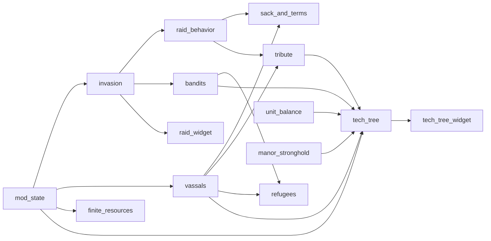

# Invasion Mod features

The mod loads features in dependency order. See [Invasion Mod structure](invasion-mod.md) for the loader, the scheduler and the config. This page says what each feature does now. It does not add design. The design is in [`design/`](../../../design/mod/invasion-mod.md), which the user writes. Mod doc rules: [`design/mod/README.md`](../../../design/mod/README.md).

Every command name starts with `InvasionMod.`. The tables omit that prefix. Commands are registered with `HarnessCommands`. The harness and the agent call them. Mods and scenarios do not use eval. Most features have a `*_state` command that returns the current values.

## Dependency graph

An arrow means "is required by". `example`, `unit_balance` and `manor_stronghold` have no requirements. The source of truth is `feature_list.lua`, which must equal `mod.json`.

## Summary

| Feature | Spec | Requires | Scenarios |
| --- | --- | --- | --- |
| example | none (layout stub) | none | none |
| mod_state | [M01](../../../openspec/changes/archive/2026-10-16-legacy-m01-mod-state/README.md) | none | `scenarios/mod_state/` |
| invasion | [M02](../../../openspec/changes/archive/2026-10-16-legacy-m02-invasion/README.md) | mod_state | `scenarios/invasion/` |
| raid_widget | [M02](../../../openspec/changes/archive/2026-10-16-legacy-m02-invasion/README.md) (iteration 05) | invasion | `scenarios/invasion/raid_widget.py` |
| raid_behavior | [M03](../../../openspec/changes/archive/2026-10-16-legacy-m03-raid-behavior/README.md) | invasion | `scenarios/raid_behavior/` |
| bandits | [M04](../../../openspec/changes/archive/2026-10-16-legacy-m04-bandits/README.md) | invasion | `scenarios/bandits/` |
| unit_balance | [M05](../../../openspec/changes/archive/2026-10-16-legacy-m05-unit-balance/README.md) | none | `scenarios/unit_balance/` |
| sack_and_terms | [M06](../../../openspec/changes/archive/2026-10-16-legacy-m06-sack-and-terms/README.md) | raid_behavior, vassals | `scenarios/sack_and_terms/` |
| vassals | [M07](../../../openspec/changes/archive/2026-10-16-legacy-m07-vassals/README.md) | mod_state | `scenarios/vassals/` |
| tribute | [M08](../../../openspec/changes/archive/2026-10-16-legacy-m08-tribute/README.md) | vassals, raid_behavior | `scenarios/tribute/` |
| refugees | [M09](../../../openspec/changes/archive/2026-10-16-legacy-m09-refugees/README.md) | vassals, bandits | `scenarios/refugees/` |
| finite_resources | [M10](../../../openspec/changes/archive/2026-10-16-legacy-m10-finite-resources/README.md) | mod_state | `scenarios/finite_resources/` |
| tech_tree | [M12](../../../openspec/changes/archive/2026-10-16-legacy-m12-tech-tree/README.md) | bandits, unit_balance, mod_state, manor_stronghold, vassals, tribute | `scenarios/tech_tree/` |
| tech_tree_widget | [M12](../../../openspec/changes/archive/2026-10-16-legacy-m12-tech-tree/README.md) (iteration 02) | tech_tree | `scenarios/tech_tree/widget.py`, `widget_laws.py`, `widget_key.py` |
| manor_stronghold | [M13](../../../openspec/changes/archive/2026-10-16-legacy-m13-manor-stronghold/README.md) | none | `scenarios/manor_stronghold/` |

The feature `liege_influence` (change `add-liege-influence`, #271, replaces the old M11 spec) needs `mod_state` and `tribute`. The player pays silver from the lord treasury as tribute (commands `liege_state`, `liege_send_tribute`, or the pak widget `WBP_LiegeTribute`) and gets influence: 10 silver for 1 influence, no decay, no cap. Test scenarios: `scenarios/liege_influence/`.

Specs without code: [M14 plundered_start](../../../openspec/changes/archive/2026-10-16-legacy-m14-plundered-start/README.md) is out of scope for the first release. M14 has no feature folder.

## Features

### example
A stub. It shows the layout and proves that a feature module loads. It does nothing else. Its row patches (`data/example/patches/`) test the pak build.

### mod_state (M01)
Keeps the values of the mod inside the save through the shared module `ModState`. Other features call `ModState.open("invasion", "pawn", version)` and `register(key, default, kind)`. The state is stored in the player pawn `Tags` in Lua, never through the bridge `set`. `config.mod_state.keys` registers the `selftest_*` keys for the M01 scenarios.
Commands: `mod_state_dump`, `mod_state_get`, `mod_state_set`, `mod_state_add_foreign_tag`.

### invasion (M02)
The mod owns the raid timer. Files: `plan.lua`, `difficulty.lua`, `great_raid.lua`, `target.lua`, `relief.lua`, `lord_raid.lua`, `init.lua`. The plan lives in ModState, so it survives a load. A scheduler job polls the game day (`poll_ms`).
- A minor raid is planned after a start window. A daily banner shows a size estimate. The raid spawns on the planned day, with squads scaled by size class and difficulty.
- A subjugation raid (major) is planned after the first raid.
- The great raid clock, its waves, the relief army and the final battle (iterations 02 and 06).
- Difficulty 1 to 3, picked by the player (iteration 04). Raid squads use Hussite roles (`config.invasion.roles`): melee and ranged tiers from game unit templates. With `lord_army` the raid is the army of an AI lord at war with the player, else bandit squads.
- Vassals can be targets (iteration 07, `target.lua`).
Commands: `invasion_state`, `invasion_force_next`, `invasion_set_difficulty`, `invasion_set_size`, `invasion_set_roles`, `invasion_raid_squads`, `invasion_difficulty_state`, `invasion_pick_difficulty`, `invasion_clock_state`, `invasion_clock_set_days_left`, `invasion_great_state`, `invasion_great_force_start`, `invasion_great_skip_wait`, `invasion_subjugation_state`, `invasion_subjugation_force_next`.

### raid_widget (M02 iteration 05)
One menu for all raid information. The layout is a cooked Widget Blueprint in `raidmenu_P.pak` (`ue/make_raid_widget.py`): a title, text lines and three difficulty buttons. Lua fills the texts (`lines.lua`) and polls the buttons. F8 opens and closes the menu (`config.raid_widget.toggle_key`); the key only sets a flag, the scheduler tick toggles (see [Shared patterns](#shared-patterns)). A click on a difficulty button picks the difficulty until the first raid or the first pick.
Commands: `raid_widget_open`, `raid_widget_close`, `raid_widget_state`.

### raid_behavior (M03)
Tracks a raid that runs under the native plunder AI. The mod adds no steering and no rout. It counts living raiders and carried loot, and gives the loot of a dead raider back to the nearest store. Numbers live in ModState and in the log line `RAID_BEHAVIOR`. Other features listen to it (for example `sack_and_terms`, `tribute`).
Commands: `raid_behavior_state`, `raid_behavior_claim_back`, and test helpers `raid_behavior_test_set_leave`, `raid_behavior_test_take_region`, `raid_behavior_test_kill_raiders`.

### bandits (M04)
Low approval lowers Public Order. Low Public Order turns families into bandits. The mod writes `Region.publicOrder = natural - debuff`, and takes the value the game writes back as the new natural value. The conversion uses the `homeless_rebel` route. The tick runs once per season change, and the last season is saved in ModState so a load does not repeat a season. The player can buy a converted family back.
Commands: `bandits_state`, `bandits_set_approval`, `bandits_tick_now`, `bandits_buy_back`.

### unit_balance (M05)
Changes unit values: armor, weapon, reach and veterancy. A new unit with low def gets def and block cut by a factor. An armored unit gets a weapon bonus. Long reach and experience add att and def. The feature polls known units because no spawn hook exists and a live write is lost for units that spawn later (specs 25 and 28). A known unit costs one read.
Commands: `unit_balance_state`, `unit_balance_set`, `unit_balance_apply`.

### vassals (M07)
Keeps a registry of vassal slots in ModState: region, lord name, loyalty and start day. The game goal is Endless, so a claim never ends the game (spec 26). Loyalty, keep peace, policy, gifts, loss of a vassal and a submission tick are implemented.
Commands: `vassals_state`, `vassals_claim`, `vassals_set_loyalty`, `vassals_set_keep_peace`, `vassals_set_policy`, `vassals_order_gift`, `vassals_loyalty_tick_now`, `vassals_lose`, `vassals_set_loss_region`, `vassals_submission_tick_now`, `vassals_set_goal`.

### sack_and_terms (M06)
Files: `init.lua` (sack), `terms.lua` (terms), `fallback.lua` (fallback capital), each with a `*_rules.lua`. When a role raid begins to leave because it won, the town loses a share of buildings and families. The mod takes no goods; a fire may destroy part of the goods of a burned store (11 to 60 percent measured). Villagers put out a sack fire unless enemy soldiers are near, so the default method is `collapse` (rubble at once). The share grows with difficulty. Terms and the fallback capital are first forms (marked TBD in the source): the player pays to make a fortified vassal the fallback capital, the mod takes the region back from its lord, moves grain and sends settlers. Moving units and removing families are not done (spikes S11 and S8).
Commands: `sack_state`, `sack_now`, `sack_set_fatal`.

### tribute (M08)
At each season change each handed-over vassal pays goods into the player stores, as a share of a production formula. No goods move between regions. The mod adds goods to a home store.
Commands: `tribute_state`, `tribute_tick_now`, `tribute_test_raid_result`.

### refugees (M09)
A lost vassal sends a wave of refugee families to the home region. Families arrive through `settleRegion` (five families a call, the homeless tent). The game lowers approval and feeds them. Another feature calls `send_wave(vassal_families)` when a vassal is lost. The feature reuses `features.bandits.world.rebel`.
Commands: `refugees_state`, `refugees_set_timeout`, `refugees_vassal_lost` (test path), `refugees_send_wave`.

### finite_resources (M10)
Home deposits (iron first) are a mod-owned stock. The mod counts what player buildings produce (`ProductionTrackerComponent:getGoodsProducedOver`). When the stock is used up it sets the production limit of the good to 0 for the player region (`Region:setProductionLimit`). Goods from vassals do not count and are not blocked. Spike note: `openspec/changes/archive/2026-10-16-legacy-m10-finite-resources/implementation-notes/iteration-01-iron-deposit.md`.
Commands: `finite_resources_state`, `finite_resources_test_set`, `finite_resources_test_clear`.

### manor_stronghold (M13)
The manor is the safest store. The store is owned by the mod (spec 12): `HarnessManor` keeps goods in the building inventory and refuses a put above the capacity. This feature sets the capacity from the tech tree bonus. `retinue.lua` and `squads.lua` add retinue squads above the native limit of 12 men, with `spawnArmy` and the player pawn as owner. The mod pays the silver and keeps the squad ids.
Commands: `manor_state`, `manor_put`, `manor_take`, `retinue_state`, `retinue_hire`, `retinue_squad_hire`, `retinue_squad_state`.

### tech_tree (M12)
Two exclusive paths (Oppression, Prosperity). The nodes come from `data/tech_tree/tree.json`. The player picks one path and unlocks nodes for free. One node slot opens for each settlement level. Lua applies the effects through other features: bandits, unit_balance, manor_stronghold, vassals and tribute (this is why it has six requirements). Laws and vassal policy are set here. A bad data file stops the load of this feature with a clear message.
Commands: `tech_tree_state`, `tech_tree_choose_path`, `tech_tree_unlock`, `tech_tree_enact_law`, `tech_tree_repeal_law`, `tech_tree_set_vassal_policy`.

### tech_tree_widget (M12 iteration 02)
The menu of the tech tree. `techmenu_P.pak` holds a cooked Widget Blueprint with a pool of node buttons on a canvas (`ue/make_tech_widget.py`). Lua labels, shows, hides, colours and moves the buttons from the nodes of `tech_tree`. F9 opens and closes it (`toggle_key` in config); the key only sets a flag, the scheduler tick toggles. Scenario `tech-tree-widget-key` presses the real F9 key (`--pak techmenu`). A click calls `tech_tree`.
Commands: `tech_tree_widget_open`, `tech_tree_widget_close`, `tech_tree_widget_state`, `tech_tree_widget_press`.

## Shared patterns

- Split of files: `rules.lua` is pure logic that fake-game tests run without the game. `world.lua` touches game objects. `init.lua` wires state, scheduler jobs and commands.
- Season-change ticks (bandits, tribute) store the last handled season in ModState. A load must not repeat a tick.
- Both widget features obey the rule: game objects only on the game thread, no `LoopAsync` of their own.
- Key binds: a `RegisterKeyBind` callback runs on the input thread, not the game thread. It only sets a flag (`toggle_requested`); the scheduler tick on the game thread reads it and toggles the menu. Lua work in the callback raced with the game thread and crashed the game in `luaH_getint` (F9, issue #245, [f9-key-crash.md](../../../openspec/changes/archive/2026-10-16-legacy-m12-tech-tree/implementation-notes/f9-key-crash.md)).
- A feature that needs a game fact not yet known has a spike note: in `openspec/changes/<change-name>/notes/` (open or archived changes), or in the legacy `docs/mod/M<NN>-<feature>/implementation-notes/`. Read that note before you change the code.

## Tests

- Fake-game tests: `harness/tests/test_fakegame_<feature>.py` (`modstate`, `bandits`, `invasion`, `tech_tree`, `vassals`) and rule tests such as `test_bandits_rules.py`, `test_invasion_plan_roles.py`. Run: `uv run python -m unittest discover -s harness/tests -p "test_fakegame_*.py"`.
- Real-game scenarios: the table above. Run them as in [Scenario run](../workflows/scenario-run.md).
- Command contracts: [Mod commands and state](../concepts/mod-commands-and-state.md).
