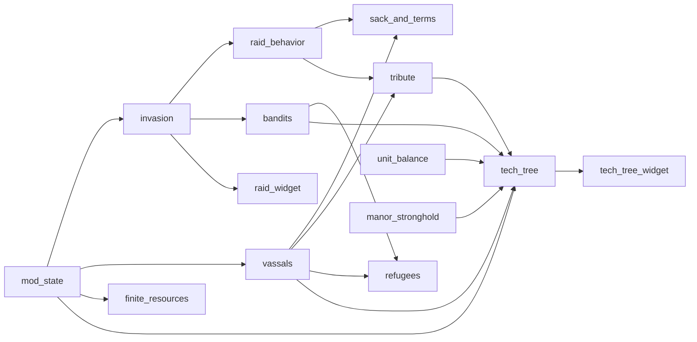

# Invasion Mod features

The mod loads features in dependency order. See [Invasion Mod structure](invasion-mod.md) for the loader, the scheduler and the config. This page says what each feature does now. It does not add design. The design is in [`design/`](../../../design/mod/invasion-mod.md), which the user writes. Mod doc rules: [`design/mod/README.md`](../../../design/mod/README.md).

Every command name starts with `InvasionMod.`. The tables omit that prefix. Commands are registered with `HarnessCommands`. The harness and the agent call them. Mods and scenarios do not use eval. Most features have a `*_state` command that returns the current values.

## Dependency graph

An arrow means "is required by". `example`, `unit_balance` and `manor_stronghold` have no requirements. The source of truth is `feature_list.lua`, which must equal `mod.json`.

## Summary

| Feature | Spec | Requires | Scenarios |
| --- | --- | --- | --- |
| example | none (layout stub) | none | none |
| mod_state | [M01](../../../openspec/changes/archive/2026-10-16-legacy-m01-mod-state/README.md) | none | `scenarios/mod_state/` |
| invasion | [M02](../../../openspec/changes/archive/2026-10-16-legacy-m02-invasion/README.md) | mod_state | `scenarios/invasion/` |
| raid_widget | [M02](../../../openspec/changes/archive/2026-10-16-legacy-m02-invasion/README.md) (iteration 05) | invasion | `scenarios/invasion/raid_widget.py` |
| scenario_settings | change `add-scenario-settings-menu` (#375) | invasion | `scenarios/scenario_settings/` |
| raid_behavior | [M03](../../../openspec/changes/archive/2026-10-16-legacy-m03-raid-behavior/README.md) | invasion | `scenarios/raid_behavior/` |
| bandits | [M04](../../../openspec/changes/archive/2026-10-16-legacy-m04-bandits/README.md) | invasion | `scenarios/bandits/` |
| order_tooltip | change `add-order-tooltip-rows` (#454) | bandits | `scenarios/order_tooltip/` |
| unit_balance | [M05](../../../openspec/changes/archive/2026-10-16-legacy-m05-unit-balance/README.md) | none | `scenarios/unit_balance/` |
| sack_and_terms | [M06](../../../openspec/changes/archive/2026-10-16-legacy-m06-sack-and-terms/README.md) | raid_behavior, vassals | `scenarios/sack_and_terms/` |
| vassals | [M07](../../../openspec/changes/archive/2026-10-16-legacy-m07-vassals/README.md) | mod_state | `scenarios/vassals/` |
| tribute | [M08](../../../openspec/changes/archive/2026-10-16-legacy-m08-tribute/README.md) | vassals, raid_behavior | `scenarios/tribute/` |
| refugees | [M09](../../../openspec/changes/archive/2026-10-16-legacy-m09-refugees/README.md) | vassals, bandits | `scenarios/refugees/` |
| finite_resources | [M10](../../../openspec/changes/archive/2026-10-16-legacy-m10-finite-resources/README.md) | mod_state | `scenarios/finite_resources/` |
| tech_tree | [M12](../../../openspec/changes/archive/2026-10-16-legacy-m12-tech-tree/README.md) | bandits, unit_balance, mod_state, manor_stronghold, vassals, tribute | `scenarios/tech_tree/` |
| tech_tree_widget | [M12](../../../openspec/changes/archive/2026-10-16-legacy-m12-tech-tree/README.md) (iteration 02) | tech_tree | `scenarios/tech_tree/widget.py`, `widget_laws.py`, `widget_key.py`, `widget_picks.py`, `widget_layout.py` |
| manor_stronghold | [M13](../../../openspec/changes/archive/2026-10-16-legacy-m13-manor-stronghold/README.md) | none | `scenarios/manor_stronghold/` |

The feature `liege_influence` (change `add-liege-influence`, #271, replaces the old M11 spec) needs `mod_state` and `tribute`. The influence is a saved value with no decay and no cap. Only contracts change it (feature `liege_contracts`, below). It offers `change_influence`, `add_silver` (the HUD refresh is a call of `updatePlayerStats`) and the command `liege_state` (`influence`, `silver`, `day`). The silver tribute is gone (change `update-liege-tribute-to-contracts`, #505). The arms shipment (change `add-scenario-start-kit`, #425) is gone too (change `update-liege-contracts-tiers`, #533): a Medium contract can pay weapons. An old save that holds `arms_last_day` loads; the key is ignored. Test scenarios: `scenarios/liege_influence/`.

The feature `liege_contracts` (changes `update-liege-tribute-to-contracts`, #505, and `update-liege-contracts-tiers`, #533) needs `mod_state`, `invasion` and `liege_influence`. Its folder `Scripts/features/liege_contracts/` has `loader.lua` (checks `data/liege_contracts/contracts.json`), `rules.lua` (request amount, draw, saved text, refusal reasons, calendar; pure), `view.lua` (window texts; pure), `world.lua` (stock, goods take and add, regional wealth, manor check, day of the year) and `init.lua` (state, tick, commands, window).
- Offer: at each start of spring (`invasion.season_info()`: season value and counter; spring 1, winter 0) the feature draws 3 different requests for each tier Small, Medium and Large (9 contracts), each with one reward from the pool of its tier. The offer is made with or without a manor. The first look after a load only takes the counter (no offer at a new game). Winter clears the offer, with no penalty.
- Request: one good of the tier (tier 1, 2 and 3 goods) and `max(1, round(base(tier) * weight(good) * difficulty))`. Base and tier limits are in `config.liege_contracts`; the weight of a good is in `contracts.json` (config `weight[id]` overrides it); difficulty is `config.liege_contracts.difficulty[yearly raid level]`. JSON nesting is limited to 6 levels by `HarnessJson`, so the reward good lists are in the top level field `good_lists`.
- Fulfil: needs a built manor (`HarnessManor.manor_state()`, cached for the window, fresh for a click and the command), goods in the stores of the player region (`consumeGoodNoCheck` on the stores of types 6, 72, 50, 57, 58, 81, 82, 83, 95 and 98) and a tier count below the limit. Rewards: `goods` and `weapons` (first storehouse), `regional_wealth` (`Region:addRegionalWealth`), `silver`, `tech_point` (adds to `tech_picks_earned`; drawn only when the tech tree has that state) and `influence`.
- Countdowns: `TemporalComponent.day` is the day of the year; the config gives the start day of spring (60) and winter (335) (see `engine-limits.md`).
- State keys (ModState strings allow only letters, digits, `_`, `.`, `-`): `contracts_spring_no`, `contracts_offer` (one contract is `<tier letter>-<good>-<amount>-<reward letter>-<reward good>-<reward amount>-<done 0|1>`), `contracts_used` (`s-1.m-0.l-0`) and `contracts_done`. An old save's offer and active contract are dropped.
- The pak widget `WBP_LiegeContracts` (generator `ue/make_liege_widget.py`) is a canvas of 1152 x 632 with 9 fixed cards, 3 tier boxes and a top bar (no Close button of its own: the base menu adds the game's Close at the bottom middle); the base menu id is `liege`.
- Commands: `liege_contracts_state`, `liege_contract_fulfil` (`id` such as `small-1`), `liege_contracts_offer_now` (optional `ids` in the saved text form), `liege_menu_open`, `liege_menu_close`, `liege_menu_state`, `liege_menu_press` (`button`; the same code as a click, for a PC with no mouse device). Test scenarios: `scenarios/liege_contracts/`. Spike notes: `openspec/changes/update-liege-contracts-tiers/notes/` (then the archive).

### example
A stub. It shows the layout and proves that a feature module loads. It does nothing else. Its row patches (`data/example/patches/`) test the pak build.

### mod_state (M01)
Keeps the values of the mod inside the save through the shared module `ModState`. Other features call `ModState.open("invasion", "pawn", version)` and `register(key, default, kind)`. The state is stored in the player pawn `Tags` in Lua, never through the bridge `set`. `config.mod_state.keys` registers the `selftest_*` keys for the M01 scenarios.
Commands: `mod_state_dump`, `mod_state_get`, `mod_state_set`, `mod_state_add_foreign_tag`.

### invasion (M02)
The mod owns the raid timer. Files: `plan.lua`, `difficulty.lua`, `great_raid.lua`, `target.lua`, `relief.lua`, `lord_raid.lua`, `init.lua`. The plan lives in ModState, so it survives a load. A scheduler job polls the game day (`poll_ms`).
- Raid clock (change `update-raid-clock-yearly`): no raid in game year 1. From year 2 one raid a year. At each season change `yearly_step` rolls once (`config.invasion.yearly.chance_by_season`, default 25, 33, 50, 100 percent; the fourth season always raids). The pure rules are `plan.season_year`, `plan.should_raid` and `plan.yearly_raid`. A season change is counted in ModState (`yearly_season_no`, `yearly_last_season`, `yearly_done_year`), saved before the roll like in `mod/bandits`, so a load does not roll again. Year 1 is the first 4 seasons after the mod started. A successful roll plans a raid 1 to `season_days` (90) game days ahead. Kind rules: the first yearly raid is plunder, the second is the subjugation raid (once), later raids are plunder again (`plunder_spawned`, `sub_spawned`).
- Banners (change `update-raid-banners`): a yearly raid has no banner, except a large plunder raid (the player raid). A subjugation raid and a large plunder raid show one banner, `config.invasion.raid_banner_days` (30) game days before the raid day (or on the plan day), with the target (`you` or `your vassal <name>`) and the size estimate. The flags `plunder_banner` and `sub_banner` in ModState stop a repeat after a load. The vassal of a subjugation raid comes from the saved `sub_seed`, so the banner and the spawn name the same one. There is no difficulty banner (the settings menu owns the difficulty). The raid spawns on the planned day, with squads scaled by size class and the level of the raid type. Each raid type has its own level 0 (off), 1 (easy), 2 (medium) or 3 (hard) in the mod state: `level_yearly` (the plunder raid, also the small one), `level_great` (clock, waves, relief army) and `level_vassal` (the subjugation raid). Level 0 plans no raid, spawns none and shows no banner or list entry. `invasion.difficulty()` (the highest level, at least 1) is the one number for bandits, sack and terms. The global difficulty and the `great_raids` switch are gone (change `update-raid-difficulty-levels`, #404).
- The great raid clock, its waves, the relief army and the final battle (iterations 02 and 06). The clock ends at the first day of game year `great_raid.start_year` (default 10; the year is the count of season changes of the yearly rule, 4 a year). `great_raid_day` is an estimate (92 days a season) until that year begins, then it is set to the real day. One clock banner (`Great raid in N years`) shows at the start of each of the 3 years before: only when the year changed in this Lua session, so a load skips a missed one, and `last_clock_banner_year` stops a repeat. None at great level 0.
- Map border (change `update-spawn-from-map-border`, #434): `border.lua` holds the pure rules (`pick`: the nearest side that is at least `min_spawn_distance` away, `inset` from the corners; `direction`: 8 compass words; `is_outside`) and `read_bounds` (the map edge actor splines). `lord_raid.plan_border` picks the point for the player manor; `lord_raid.start(templates, settings, point)` spawns each squad there (`lord_spawn_army` with absolute `x`, `y`). The invasion spawns `march_lead_days` (5) before the raid day, shows "Raiders approach from the <direction>" and, at arrival, "Raiders are here". `raid_behavior` marks the raid `marching` until a fifth of its raiders stand within `arrival_radius` of the manor (or `max_march_days`): no leave, plunder or steal rule and no listing in `active_raids` until then. At arrival `start_day` is the day, `initial` is the living raiders, and `invasion.on_arrival` moves the wave gap (`gr_last_day`). `invasion.border.enabled = false` brings back the old spawn near the manor. The relief army is not moved (`relief_offset`). Config: `invasion.border`. Facts: [Engine limits](../concepts/engine-limits.md). Test scenarios `invasion-border-arrival`, `invasion-great-raid-waves`.
- Levels 1 to 3, picked by the player in the settings menu (iteration 04). Raid squads use Hussite roles (`config.invasion.roles`): melee and ranged tiers from game unit templates. With `lord_army` the raid is the army of an AI lord at war with the player, else bandit squads.
- Vassals can be targets (iteration 07, `target.lua`).
- Corpse pit loot (change `add-corpse-pit-loot`; since change `update-tech-tree-yearly-picks` it pays only while the law Strip the Dead is in force, see `tech_tree`): `raid_behavior` records the goods of each plunder tick per Hussite raid (`raid.plunder_goods`, text key `raid_plunder_record`). `pit_poll` (each `pit_poll_ms`) reads the corpse count (`Type 233`) of the pit (building 113); each rise pays one share (`floor(record / initial)`) for each unpaid dead Hussite raider (`rules.pay_bodies`) with `addToInventory`. No hook exists for a delivery. Without the law a delivered body is consumed and pays nothing. With the law, the dead of tracked native and bandit raids (`raid.unpaid_other`) pay one variant of `config.raid_behavior.body_loot.bandit` each (a random list entry by weight; owner variants 2026-10-28: sword 177 and small shield 270, with or without a militia helmet 273), and `raid_behavior.watch_looted` tells the tech tree, which lowers the mod order by `strip_the_dead.order_loss` for each looted body (`bandits.adjust_order`). Villager, militia and soldier bodies are not told apart (a pit body has no identity), so they pay nothing; the `soldier` entry of `body_loot` is empty. A missing pit gives nothing. Test command `raid_behavior_pit_state` (also `unpaid_other`).

Commands: `invasion_state`, `invasion_force_next`, `invasion_set_difficulty` (all three levels, 0 to 3), `invasion_set_level` (`kind` yearly, great or vassal, and `value`), `invasion_set_size`, `invasion_set_roles`, `invasion_raid_squads`, `invasion_difficulty_state`, `invasion_pick_difficulty`, `invasion_clock_state`, `invasion_clock_set_days_left`, `invasion_great_state`, `invasion_great_force_start`, `invasion_great_skip_wait`, `invasion_subjugation_state`, `invasion_subjugation_force_next`, `invasion_yearly_state`, `invasion_yearly_advance_season` (test: counts one season change and rolls, optional fixed `roll`), `invasion_plan_now` (test: plans a raid now, optional `kind`). `invasion_force_next` plans a plunder raid first when none is planned.

### raid_widget (M02 iteration 05)
One menu for all raid information. The layout is a cooked Widget Blueprint in `InvasionMod_P.pak` (`ue/make_raid_widget.py`): a title, text lines and three unused Borders (the old difficulty buttons). Lua fills the texts (`lines.lua`). The menu is built on the base menu ([Base menu](#base-menu)): a Raid button in the game's bottom bar opens it with one click. F8 stays as a shortcut (`config.raid_widget.toggle_key`); the key only sets a flag, the base menu tick toggles (see [Shared patterns](#shared-patterns)). The menu has no difficulty buttons (removed by change `add-scenario-settings-menu`): the player picks the difficulty in the scenario settings menu. Since change `update-raid-banners` the lines are: yearly raid, subjugation raid (type, target, size, days left; each shows "not planned yet" when no raid is planned), great raid, difficulty, terms. A switched-off raid type (subjugation off, great raids off) has an empty line. The old text: the line "Great raid" showed "off" when Great raids is Off.
Commands: `raid_widget_open`, `raid_widget_close`, `raid_widget_state`.

### scenario_settings (change `add-scenario-settings-menu`, #375)
The menu that opens when a new game starts: a title, a background text, five rows (Yearly player raid, Great raid and Vassal raids with the choices Off, Easy, Medium and Hard; First Hussite raid; Raid size) and the buttons "Use defaults" and "Begin the game". Built on the base menu ([Base menu](#base-menu)) with `bar = false` (no bottom bar button). The layout is the cooked Widget Blueprint `WBP_ScenarioSettings` in `InvasionMod_P.pak` (`ue/make_scenario_settings_widget.py`; click buttons are `WBP_ClickButton`). Texts, defaults and limits are in `config.scenario_settings`; the background text is a placeholder until the owner writes it.
- **New game or loaded save** (`rules.kind_of_game`, decided once per session when the mod state is loaded): `settings_applied` = 1 means loaded. An empty `MLGameInstance.savefileToLoad` and a game day of at most `new_game_max_day` means new. A save file name (or a late day) means an old save: it gets the config defaults and no menu. A new game opens the menu after the intro (`currentUIMode` 0) and pauses (`pauseGame`).
- **Hold gate:** while a new game waits for the menu, the invasion feature runs no daily step (no "Pick the difficulty" banner, no clock). `invasion.set_hold_gate`.
- **Begin** (or the Close button) stores the five values in the mod state of `invasion` (`level_yearly`, `level_great`, `level_vassal` + `difficulty_chosen`, `first_raid_years`, `size_class_fixed`, `settings_applied`), un-pauses (`unPauseGame`, then `changeGameSpeed(begin_speed)`: a new game starts at speed 0 and `unPauseGame` alone does not run it) and sends `disable_autosave` again (`HarnessAutosave`). The mod never calls a save function.
- **Effects:** `first_raid_years` N: the season roll of `invasion` starts in year N+1 (`plan.should_raid` argument `first_year`). `size_class_fixed` 1 to 3: the plunder raid has that class (0: random). `level_great` 0: no clock, no clock banner, no waves; `level_yearly` 0: no yearly raid (and no small raid); `level_vassal` 0: no subjugation raid. The raid widget shows "Great raid: off" and "Next raid: off", and the line "Raid levels: yearly Y, great G, vassal V".
- A menu that cannot open (a missing pak) logs the reason, applies the defaults and does not pause.
- Guard (change `add-game-settings-guard`, #438): the mod state key `vassals` (1, 0, or -1 not known) is set once in `decide`: a new game reads `ai_lords` (`numGenericAILords`) through `HarnessGameSetup.game_setup_state()`; a loaded save without the value counts the `PawnCPP_AI` pawns (the live check) and stores the result. When `vassals` is 0, `rules.background_with_warning` adds `config.scenario_settings.vassals_warning` below the background text. Nothing is locked. `scenario_settings_state` shows `vassals` and `warning`.
- Registered mod state defaults keep the old behaviour (year 2, random size, levels 1). The config defaults (levels 2, 2 years, Medium) are written by the menu, by `scenario_settings_skip` and for an old save.
- Commands: `scenario_settings_state`, `scenario_settings_skip` (defaults, closes the menu), `scenario_settings_set` (any of `yearly`, `great`, `vassal`, `first_raid_years`, `size_class`), `scenario_settings_open`, `scenario_settings_click` (test: `action` choose, defaults or begin).
- Tests: `test_fakegame_scenario_settings.py`; test scenarios `scenario-settings-new-game-menu` (`--new-game --pak InvasionMod`), `scenario-settings-player-launch-pause` (also `--env HARNESS_BOOT_NO_PAUSE=1`; the menu re-pauses when the clock moves, `pause_guard_epsilon`), `-first-raid-delay`, `-great-raids-off` (great level 0), `-load-keeps-settings` (needs the guarded `save_game`; not run yet).
- Start kit (change `add-scenario-start-kit`, #425): `apply` calls `give_kit` for a new game only (`S.new_game`, set by `decide`). It sets the population to `config.start_kit.villagers` (10) by killing living people, last family first (`just_die`); a smaller village keeps its people (no safe add call) and `silver` of the player pawn to 300. The mod state key `start_kit_given` stops a second kit and a kit after a load. A new game of the harness already starts with 5 families of 2 people and 0 silver. Command `start_kit_state`; test scenario `scenario-settings-start-kit`.
- A test scenario on a fixture (a loaded save) never sees the menu. A fixture counts as an old save and gets the defaults (first raid in year 3): a test that needs the raid in year 2 calls `scenario_settings_set first_raid_years=1` first.
- Template (change `add-hussite-scenario-template`, #451): the pak row `hussites_are_coming` gives a 6th template "The Hussites Are Coming" on the game's New Game screen (see [Pak mods](../workflows/pak-mods.md)). The mod marks the choice in the mod state key `hussite_template` at new game start (`rules.is_hussite_template`: Royal tax None, Weather Difficult, Approval Low penalty, AI lords 0, adversary absent, no camps), because the game keeps no template name. Test scenario `scenario-settings-hussite-template` (`--pak InvasionMod --pak InvasionMod`, real mouse; `HUSSITE_CONTINUE=1` goes on to the new game).
- The new or loaded decision is made again after each ModState load (a new pawn), so a new game after a load in one session opens the menu.

### raid_behavior (M03)
Steers the larger Hussite raids and tracks every raid that the invasion feature spawns. A native raid is only tracked: the mod does not steer, rout or remove it. A raider counts as living only while the game unit census counts it (its squad is known to `HarnessUnits.squadMap`; a dead or uncounted unit is gone). The loot of a dead raider stays with the body (the corpse pit change `spike-corpse-pit-loot` will return it), and a bandit squad raid is not sent home by the mod. Numbers live in ModState and in the log line `RAID_BEHAVIOR`. Other features listen to it (for example `sack_and_terms`, `tribute`).
Store tiers and steal (change `add-raid-storage-tiers`): `config.raid_behavior.store_tiers` maps an EBuildingType to a tier. Tier 1 is the storehouse (6) and the granary (72); tier 2 is the manor modules (50, 57, 58, 81, 82, 83, 95, 98). `world.plunder(amount, tiers)` takes goods from tier 1 stores only, the store with most goods first. The baron steal (`rules.steal_amount`, `config.raid_behavior.steal`) runs once a game day for a lord raid of kind plunder (goal 100) or great (goal 300): each living raider farther than `threshold` (20000 game units, 200 m) from the battle marker (the lord anchor) takes `rate` (10) goods, up to the goal. `stolen` is in the raid summary. A game raid (native `spawnRaiders`) has no mod steal and may rob the manor store; the mod does not protect it.
Loot override (`loot_override.lua`, change `update-banditry-rebellion-raid`): a map from a unit to a list of goods. Any feature may call `set(ref, goods)`; the rebellion does. Saved in ModState as fixed string slots `loot_slot_1..200` (`<squad>_<unit index>_<id>x<count>-...`, cleared to the empty string, never removed). A poll every second (`override_poll_ms`) marks the entries of dead units (an entry stays with its body about 30 game days), drops the entries of living units that left the map, and after a load (the player pawn address changes) reads the slots and gives each squad's entries to the units of that squad in order (`relink`, window `relink_window_s` 10 game s; later entries are dropped and logged). At the corpse pit, a rise of the corpse count pays the dead entries first (oldest death first, one per body) with `addToInventory`; the other bodies follow the Hussite rule. The pit cannot tell whose body arrived, so a body of a villager can pay the entry of a killed brigand. The game's plunder is not changed. Commands: `raid_behavior_override_state` (entries, unit counts, paid totals) and the test command `raid_behavior_test_kill_override_units`.
Commands: `raid_behavior_state` (also shows `steal` and `store_tiers`), `raid_behavior_claim_back`, and test helpers `raid_behavior_test_set_leave`, `raid_behavior_test_take_region`, `raid_behavior_test_kill_raiders`.
Carry cap (change `add-raid-carry-caps`, #275): the cap acts on Hussite raids only. The plundered goods of a Hussite raid never exceed `carry_cap` (10) times its raiders at the start, and `carry_cap` is also its loot goal (the leave rule and the plunder tick use it). Native raids keep the game's own loot: the native AI resets `ItemsLooted` of a raider on a raid job to about 5 within a few game seconds, so the mod does not write it. Bandit role raids have no cap. Facts from the spike: `ItemsLooted` is a plain item count with no good; role raids (`spawnArmy`) do not use it and grow `plundered` instead. `raid_behavior_state` shows `carry_cap` and `raid_type` of each raid.

### bandits (M04)
The mod keeps its own public order (mod order, saved in ModState, 100 in a new game) and writes `Region.publicOrder = mod order` at every poll. The game rewrites its value now and then, so the mod writes it again (flicker is accepted, #403). Every 30 game days a tick adds the manor term (10 plus the tech tree `order_bonus`) and subtracts 5 for each homeless family. Each tick is logged (`BANDITS tick ...`) and goes to the telemetry metric `bandits_order`. Order under 25 starts a 60 game day timer (banner at the start and 30 game days before the rebellion). The timer resets when the order reaches 25. At expiry the rebellion starts (change `update-banditry-rebellion-raid`, #480; `rebellion.lua`): `ensure_outlaw_pawn()` first, then the mod looks for valid families (a home holds at least one id of `config.bandits.rebellion_weapon_ids`; two families can share a home, whose goods count once). It picks `rebellion_families` (6, fewer when the village keeps `min_families_left`) at random. Fewer valid families block the rebellion: nothing is removed, the order does not rise, the log has `BANDITS rebellion_blocked`, `bandits_state.blocked` and the telemetry `last_blocked` show it, the timer stays expired and the next order tick (not the next poll) tries again. Otherwise the mod takes all weapon and armor goods of the chosen homes (`consumeGoodNoCheck`, counted only when the inventory falls), kills all members of the chosen families (`just_die`, bodies hidden, the members are read before the first death) and spawns `rebellion_squads` (1) squads Brigands of the pawn Outlaws at the first home (`HarnessBattle.spawn_at`, as `homeless_rebel` mode home). If the spawn fails the goods go back into the homes. The goods become loot overrides of the 18 brigands (round robin). The order rises by 25 and the timer restarts if the order is still under 25. No camp spawns. `last_leave` has `valid`, `taken`, `returned`, `overrides`, `blocked`. Test unit: one villager is one family. The player can buy the families back.
`outlaws.lua`: `ensure_outlaw_pawn()` is idempotent. It runs at game start (5 polls after the player pawn is seen), after each load (the player pawn address changes) and before each rebellion. If the pawn is missing it calls `spawnBanditCamp()` and `addPawnRelations`; the pawn exists at once. The camp cleanup runs on later polls: when the camp is built (`IsConstructed`), the 18 camp Brigands (kept as addresses, never the rebels) are killed and hidden, and `demolish(true)` is called until the camp is gone (about 80 game s in the real game). Killing the Brigands in the same tick leaves an unbuilt camp that `demolish(true)` cannot remove. The pawn survives a harness save and a load.
Commands: `bandits_state`, `bandits_set_order`, `bandits_tick_now`, `bandits_buy_back`, and the test commands `bandits_leave_now` (count), `bandits_set_timer_days_left` (days, 0 expires the timer at once), `bandits_homes` (home inventories and valid families), `bandits_stock_homes`, `bandits_ensure_outlaws` and `bandits_test_take_goods`.

### order_tooltip (change `add-order-tooltip-rows`, #454)
Requires `bandits`. A pre-hook on `BigTooltip_ApprovalAndPublicOrder_C:updateContents` (set at the first poll where `RegisterHook` works, the class loads late) waits `delay_ms` (60) and then, on the game thread, hides the native rows of `recentFactors_VB` and `pastFactors_VB`, adds one `approvalFactorWidget_C` row for each term of `bandits.order_terms()` and writes the mod order in `current_sum_txt`. `rows.lua` is the pure row builder, `widget.lua` the widget calls. A newer open drops an older pending apply (generation counter). Each row also sets its arrow angle from the sign of its value (up for positive). The texts of a new row must be written after `AddChildToVerticalBox` (the row sets its default text when it joins the list). Terms are the last tick and the leave gain; they are not saved, so after a load only the header shows until the next tick. On a failure the tooltip stays native and the mod logs once. Command: `order_tooltip_state` (hook state, header and visible rows).

### unit_balance (M05)
Changes unit values: armor, weapon, reach and veterancy. A new unit with low def gets def and block cut by a factor. An armored unit gets a weapon bonus. Long reach and experience add att and def. The feature polls known units because no spawn hook exists and a live write is lost for units that spawn later (specs 25 and 28). A known unit costs one read.
Commands: `unit_balance_state`, `unit_balance_set`, `unit_balance_apply`.

### vassals (M07)
Keeps a registry of vassal slots in ModState: region, lord name and start day. The game goal is Endless, so a claim never ends the game (spec 26). Keep peace, policy (it scales the tribute), loss, sack and restore of a vassal are implemented. A Hussite sack (a long siege, see tribute) collapses the buildings of the vassal region until 80 percent are ruins (`sack_wipe.ruin_share`), then deletes all villagers with `ManorCore.remove_families`, frees the slot (reason `wiped`) and sends a refugee wave. The land stays a village of rubble; the mod never writes the owner. A `wiped<N>` record outside the slots remembers the region. `vassals_restore` costs 100 silver, raises the village to 5 families and spawns 100 logs, 200 planks and 100 rubble stone; the restored vassal has the flag `rebuilding` and pays no tribute until 50 percent of its old buildings stand. A vassal has no loyalty: it survives or dies. Old saves hold `loyalty` and `submitted` entries in the registry; ModState keeps them as unknown entries and the feature ignores them.
Commands: `vassals_state`, `vassals_claim`, `vassals_set_keep_peace`, `vassals_set_policy`, `vassals_lose`, `vassals_sack`, `vassals_restore`, `vassals_region_census`, `vassals_set_goal`.

### sack_and_terms (M06)
Files: `init.lua` (sack), `terms.lua` (terms), each with a `*_rules.lua`. When a role raid begins to leave because it won, the town loses a share of buildings and families, the open offer of terms closes and the same raid offers no new terms (no terms after a sack of the player). The mod takes no goods; a fire may destroy part of the goods of a burned store (11 to 60 percent measured). Villagers put out a sack fire unless enemy soldiers are near, so the default method is `collapse` (rubble at once). The share grows with difficulty. Terms are a first form (marked TBD in the source). The fallback capital was removed (capital moves are not part of the game, owner decision 2026-10-20).
Commands: `sack_state`, `sack_now`, `sack_set_fatal`.

### tribute (M08)
At each season change each handed-over vassal pays goods into the player stores, as a share of a production formula. No goods move between regions. The mod adds goods to a home store. A subjugation raid on a vassal region that holds 8 game days with at least half its units alive starts the sack of the houses of that vassal (see vassals). A restored vassal pays no tribute while it is rebuilding.
Commands: `tribute_state`, `tribute_tick_now`, `tribute_test_raid_result`.

### refugees (M09)
A lost vassal (wiped by a sack) sends a wave of refugee families to the home region: 50 percent of its families (`share_min` and `share_max` are both 0.50), five families a call, three calls at most. Families arrive through `settleRegion` (five families a call, the homeless tent). The game lowers approval and feeds them. Another feature calls `send_wave(vassal_families)` when a vassal is lost. The feature reuses `features.bandits.world.rebel`.
Commands: `refugees_state`, `refugees_set_timeout`, `refugees_vassal_lost` (test path), `refugees_send_wave`.

### finite_resources (M10)
Home deposits (iron first) are a mod-owned stock. The mod counts what player buildings produce (`ProductionTrackerComponent:getGoodsProducedOver`). When the stock is used up it sets the production limit of the good to 0 for the player region (`Region:setProductionLimit`). Goods from vassals do not count and are not blocked. Spike note: `openspec/changes/archive/2026-10-16-legacy-m10-finite-resources/implementation-notes/iteration-01-iron-deposit.md`.
Commands: `finite_resources_state`, `finite_resources_test_set`, `finite_resources_test_clear`.

### manor_stronghold (M13)
The manor is the safest store. The store is owned by the mod (spec 12): `HarnessManor` keeps goods in the building inventory and refuses a put above the capacity. This feature sets the capacity from the tech tree bonus. `retinue.lua` and `squads.lua` add retinue squads above the native limit of 12 men, with `spawnArmy` and the player pawn as owner. The mod pays the silver and keeps the squad ids.
Commands: `manor_state`, `manor_put`, `manor_take`, `retinue_state`, `retinue_hire`, `retinue_squad_hire`, `retinue_squad_state`.

### tech_tree (M12)
Two exclusive paths (Oppression, Prosperity). The nodes come from `data/tech_tree/tree.json` (version 2: 8 path nodes, 3 `common_nodes`, 9 laws). The player picks one path and unlocks nodes. Each unlock costs one pick (change `update-tech-tree-yearly-picks`): `initial_picks` at the start and `picks_per_year` at each start of spring, banked when unused. The settlement level does not matter. The picks use the season counter of `invasion` (`invasion.season_info()`: the calendar `Season` value and `yearly_season_no`); a pick is earned when the season equals `config.tech_tree.spring_season` and the counter is above ModState `tech_spring_no`. ModState keys `tech_picks_earned` (-1: not started) and `tech_spring_no`. Three common techs (Corpse Robbing, Armory Census, Night Watch) need no path and open three common laws: Strip the Dead (`law_corpse_loot`: `raid_behavior.set_corpse_loot`), Disarm the Peasantry (`law_disarm_homes`: `world.disarm_homes` moves the home weapons `bandits.rebellion_weapon_ids`, fallback `tech_tree.disarm.weapon_ids`, to the storehouse every `disarm.tick_days`, with `consumeGoodNoCheck` and `addToInventory`) and Curfew (`law_banditry_gain` 0.5: `bandits.set_modifiers` scales `homeless_term`). Common laws count toward `max_active_laws`. Lua applies the effects through other features: bandits, unit_balance, manor_stronghold, vassals and tribute (this is why it has six requirements). Laws and vassal policy are set here. A bad data file stops the load of this feature with a clear message.
Commands: `tech_tree_state` (picks_earned, free_picks, spring_no, common_nodes), `tech_tree_choose_path`, `tech_tree_unlock`, `tech_tree_enact_law`, `tech_tree_repeal_law`, `tech_tree_set_vassal_policy`. Test commands: `tech_tree_test_grant_picks`, `tech_tree_test_fill_home`, `tech_tree_test_home_goods`. The window view (`view()`) still has `slots` and `free_slots`, now the picks earned and free, and lists the common laws apart in `common_laws`. A law row has `requires`, so the window finds the card of a law.

### tech_tree_widget (M12 iteration 02)
Built on the base menu: a Tech button in the bottom bar opens it; F9 stays as a shortcut.
The window of the tech tree (change `update-tech-tree-widget-layout`, #502). It follows the layout of the mockup `openspec/specs/mod/tech_tree_widget/mockups/tech-tree-layout.html`: a header (title, picks counter, close), column heads I to IV by order, the rows Oppression, Prosperity and Common with node cards and links, a laws strip ("N of 2 max" with Repeal buttons) and a footer (last result and the fixed text).
`InvasionMod_P.pak` holds a cooked Widget Blueprint with POOLS of controls on one canvas of 1152 x 704 (`ue/make_tech_widget.py`): 16 node buttons with a ring, a letter, a law name and a law button each, 6 link Borders, 2 path buttons, 2 strip places, text blocks for the header, column heads, row labels and the footer. Lua labels, shows, hides, colours and moves the pool entries from the nodes of `tech_tree` (`lines.lua` has the pure text rules, `init.lua` the controls). A card is 216 x 150 canvas pixels: the click area (name, status, effects) on top, the law name and its Enact or Repeal button in the bottom 48 pixels. A law button has the index of its card. Positions are `origin + layout * step` from `config.tech_tree_widget`. Flat colours and a letter ring stand in for icons.
F9 opens and closes it (`toggle_key` in config); the key only sets a flag, the scheduler tick toggles. Scenario `tech-tree-widget-key` presses the real F9 key (`--pak InvasionMod`). A click calls `tech_tree`.
Engine facts of the window: the stock widget puts its root at 58 percent of the viewport height, so the generator gives the root slot centre anchors (the window is centred, `position` is not set). The base menu sets every Border of the new widget to SelfHitTestInvisible right after `on_open`; that undoes a Collapsed pool entry of the first refresh, so the first tick sets the visibility again. A Border that is not a button is HitTestInvisible so it takes no clicks.
Commands: `tech_tree_widget_open`, `tech_tree_widget_close`, `tech_tree_widget_state`, `tech_tree_widget_press` (`kind` is `path`, `node`, `law`, `strip` or `close`; a refused press also refreshes the footer).
Tooltip (change `add-tech-tooltip`): `init.lua` calls `SetToolTipText` on the `Border` of each node and law button. The text is `lines.effect_lines(source, tree)`: one line for each effect of `tree.json` (percent kinds as a signed percent, add kinds as a signed number), then "Opens vassal policy ..." lines. `tech_tree_widget_state` lists the tooltip of each button. Lua only, no pak change. Test scenario `tech-tree-widget-tooltip`.

## Base menu
Change `add-mod-menu-access-rule` (#308), file `core/menu.lua`. All mod menus (`raid_widget`, `tech_tree_widget`, the tribute menu of `liege_influence`) register with `core/menu.lua`. A menu gives its id, a short label, the pak widget class and two functions: `on_open(widget)` (attach the click buttons, show the first values) and `on_close()`. The base menu does the rest:
- **Bottom bar button.** It finds the HUD widget `MainUICPP_C`, its `HorizontalBox` `main_tabs_HB`, and adds a clone of the game's own button class (`mainTabButton_C`) after the game's buttons, with a small text label. The click is the hook on `mainTabButton_C:HandleClicked` (it fires for all buttons of the class, so it matches the clone by name and only queues the click). A load makes a new HUD; a 1 s job adds the buttons again.
- **Backdrop.** A full-screen `Button` (z-order 450, dimmed) under the content (z-order 500) blocks clicks to the game. The content Borders are set to `SelfHitTestInvisible`, or a click on the empty menu background would reach the game. The backdrop has no click callback.
- **Close button.** The game's own Close button class (`/Game/UI/Common/menuButton.menuButton_C`, the Close label of the Diplomacy screen), bottom middle (anchor 0.5, 0.95, alignment 0.5), above the backdrop. Its click is the hook on `menuButton_C:DoOnReleased`. The key (F8, F9) and the Esc key also close.
- **Pause.** A menu pauses the game when it opens (`pauseGame`) and puts back the speed when it closes (`unPauseGame`, `changeGameSpeed(index)`). A game that was paused stays paused. A menu with `manages_speed = true` (the settings menu) does neither. Change `update-mod-menu-close-and-pause` (#420).
- **Esc.** `RegisterKeyBind(Key.ESCAPE)` closes the open mod menu. The game opens its own Esc menu (`mainMenu_widget_C`) on the same press, so the mod calls `continue` on it within 1.5 s and restores the speed. See [engine limits](../concepts/engine-limits.md#mod-menus-bottom-bar-button-and-click-blocking-308).
- **One menu at a time.** Opening a menu closes the open one.
- Commands: `menu_state`, `menu_open`, `menu_close`, `menu_press`, `menu_press_esc`. `menu_state` shows the buttons, the hover and the errors. Tests: `test_fakegame_menu.py`, `test_menu_widget_sites.py`, test scenarios `menu-smoke` and `menu-base`.
- The game has no click callback for a widget made at run time: do not use `OnClicked:Add` (crash, see [engine limits](../concepts/engine-limits.md#mod-menus-bottom-bar-button-and-click-blocking-308)).

## Shared patterns

- Split of files: `rules.lua` is pure logic that fake-game tests run without the game. `world.lua` touches game objects. `init.lua` wires state, scheduler jobs and commands.
- Season-change ticks (bandits, tribute) store the last handled season in ModState. A load must not repeat a tick.
- Both widget features obey the rule: game objects only on the game thread, no `LoopAsync` of their own.
- Key binds: a `RegisterKeyBind` callback runs on the input thread, not the game thread. It only sets a flag (`menu.request_toggle`); the base menu tick on the game thread reads it and toggles the menu. Lua work in the callback raced with the game thread and crashed the game in `luaH_getint` (F9, issue #245, [f9-key-crash.md](../../../openspec/changes/archive/2026-10-16-legacy-m12-tech-tree/implementation-notes/f9-key-crash.md)).
- A feature that needs a game fact not yet known has a spike note: in `openspec/changes/<change-name>/notes/` (open or archived changes), or in the legacy `docs/mod/M<NN>-<feature>/implementation-notes/`. Read that note before you change the code.

## Tests

- Fake-game tests: `harness/tests/test_fakegame_<feature>.py` (`modstate`, `bandits`, `invasion`, `tech_tree`, `vassals`) and rule tests such as `test_bandits_rules.py`, `test_invasion_plan_roles.py`. Run: `uv run python -m unittest discover -s harness/tests -p "test_fakegame_*.py"`.
- Real-game scenarios: the table above. Run them as in [Scenario run](../workflows/scenario-run.md).
- Command contracts: [Mod commands and state](../concepts/mod-commands-and-state.md).
