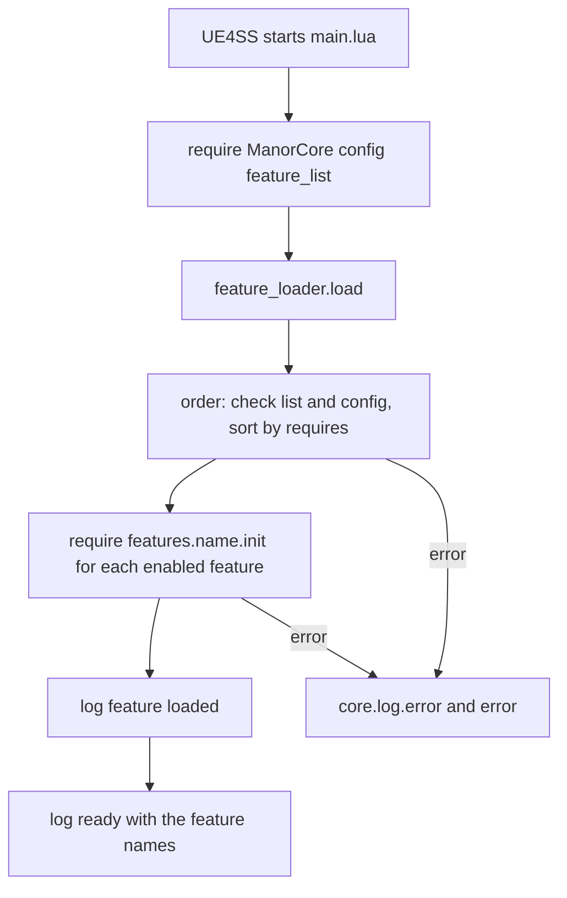

# Invasion Mod structure

`mod/InvasionMod/` is one RE-UE4SS Lua mod plus one data pak. Many features live inside it. The internal name is `InvasionMod`. The player-facing name is only `display_name` in `mod.json`. The layout comes from spec 22 ([README](../../harness/22-mod-pack-layout/README.md)). The features are listed in [Invasion Mod features](invasion-features.md).

Harness code must not name the mod or its features. The harness finds the mod through `mod.json`.

## Layout

| Path | Role |
| --- | --- |
| `mod/InvasionMod/mod.json` | Manifest: name, `display_name`, version, `shared` module list, `pak`, `tested` versions, `features` (name, `requires`, reserved `ids`), `gate_scenarios`. |
| `Scripts/main.lua` | Entry point. Loads `ManorCore`, `config`, `feature_list`, then calls `feature_loader.load`. |
| `Scripts/feature_loader.lua` | Pure logic: order the features and load them. No game API. |
| `Scripts/feature_list.lua` | The features and their `requires`. Must equal `features` in `mod.json`. |
| `Scripts/config.lua` | One table per feature: `enabled` and all balance values. |
| `Scripts/scheduler.lua` | One shared timer for all feature jobs. |
| `Scripts/features/<feature>/init.lua` | The feature. Larger features split into `rules.lua` (pure logic) and `world.lua` (game access). |
| `data/<feature>/patches/*.json` | Row patches for game tables (today only the `example` feature). `data/tech_tree/tree.json` is a data file read by Lua. |
| `scenarios/<feature>/*.py` | Real-game scenarios of the feature. |
| `ue/` | Unreal project files and `make_raid_widget.py`, `make_tech_widget.py` that cook the widget Blueprints. |
| `paks/` | Built paks: `raidmenu_P.pak` and `techmenu_P.pak`. |
| `CHANGELOG.md` | One changelog. Each entry names its feature. |

One feature name is used in `Scripts/features/`, `data/`, `scenarios/` and `docs/mod/M<NN>-<feature>/`.

## Load flow

- UE4SS puts the `Scripts` folder on `package.path`. A feature is required as `features.<name>.init`. The path is explicit because UE4SS may not search `?/init.lua`.
- `main.lua` wraps `loader.load` in `pcall`. On failure it logs `load failed: ...` through `ManorCore` and raises the error again. The mod does not start half loaded.
- On success it logs `ready, features: a, b, ...` with tag `InvasionMod`.

## Ordering rules (`feature_loader.order`)

`order(features, config)` returns the enabled feature names, each after its requirements. It fails loudly with a clear message when:
- a feature name is duplicated in the list;
- `config.lua` has a table for a name that is not in the list (`unknown feature`);
- a feature requires a name that is not in the list;
- an enabled feature requires a disabled feature (`disabled in config.lua`);
- the requirements form a cycle (the message shows the path).

A feature without a `config` entry counts as disabled. `load` stops at the first feature that fails to load and names it with its module path.

The order of the list is the tie-break: the loader visits the list in order and loads requirements first (depth first).

## Feature rules

From spec 22:
- A feature uses `ManorCore`, its own files and the API of features it lists in `requires`. Other features are reached with `require("features.<name>.init")`, which returns the module of that feature. A feature does not read another feature's local state.
- Every balance value is in `config.lua` under the feature name. Scenarios change tunables through named commands.
- No hidden save state. Values that must survive a load live in `ModState` (key registry on the player pawn). See the feature [mod_state](invasion-features.md#mod_state-m01). A feature never writes the pawn `Tags` array by hand (Safety in `CLAUDE.md`).
- The mod never calls a save function. It reacts to the player's saves through hooks.
- A feature adds new keys, commands and metrics itself. Commands use `HarnessCommands.register("InvasionMod.<name>", fn, argument_schema)`. The mod loads `HarnessCommands` with `pcall`, so it also runs without the harness.

## Scheduler

`scheduler.every(name, every_ms, run)` registers a job. The first job starts one `LoopAsync` of 100 ms (spec 34: menu clicks are hook events, so no faster tick is needed; a 50 ms tick broke the Lua state after about 3 minutes with a menu open). Each tick adds 100 ms to a clock and calls `ExecuteInGameThread(run_due)`. `run_due` runs the due jobs through `core.log.try`, so an error is logged with a stack trace and does not stop other jobs.

Why one loop: every `LoopAsync` callback runs Lua on its own thread. Several loops raced with the game thread and crashed 120-day runs (issue 163). Features must not start a `LoopAsync` of their own. Jobs run on the game thread, so they may touch UObjects.

## Config

`config.lua` returns a table keyed by feature name, each with `enabled`. Examples: `invasion.difficulty`, `invasion.great_raid.*`, `invasion.roles.*`, `raid_behavior.poll_ms`. A disabled feature is not loaded. Its data rows stay in the pak. Change a number here, not in feature logic.

## Data and pak

- Row patches are JSON files `data/<feature>/patches/*.json` with `table`, `row`, `op` (`add` or `set`), `from` and `set`. Only the `example` feature has patches now (`buildingStats` rows 1000 to 1099 and `DT_Upgrades` rows 117 to 126 reserved in `mod.json`).
- `pakmod.py buildmod InvasionMod` reads `mod.json` and all patches, checks format, conflicts and id ranges, extracts the tables from the current game paks, applies the patches in feature order, then file name, and builds one pak. See [Pak mods](../workflows/pak-mods.md) and the [build notes](../../harness/22-mod-pack-layout/implementation-notes/buildmod.md).
- Conflict check: the build fails when two features set the same field of a row or add the same row. The message names both files.
- `mod.json` field `pak` is `{"name": "raidmenu", "source": "file"}`. The committed paks in `paks/` are built from cooked assets (the widget Blueprints of `raid_widget` and `tech_tree_widget`). The AES key is never committed.
- A release copies `Scripts/` and the pak. `data/` and `scenarios/` do not go into a release. See [Mod releases](../workflows/releases.md).

## Scenarios and tests

- Scenarios: `scenarios/<feature>/*.py`. The harness finds them as `mod/<Name>/scenarios/**/*.py`. Files that start with `_` are helpers. See [Scenario run](../workflows/scenario-run.md).
- Loader test: `harness/tests/test_fakegame_featureloader.py` checks order, cycle, missing and disabled features, a failing feature, that `feature_list.lua` equals `mod.json`, and that `main.lua` logs one `ready` line.
- Run: `uv run python -m unittest discover -s harness/tests -p "test_fakegame_*.py"`. Feature tests are `test_fakegame_<feature>.py` (for example `bandits`, `invasion`, `tech_tree`, `vassals`, `modstate`). See [Fake game kit](../testing/fake-game-kit.md).

## Add a feature

1. Write the spec `docs/mod/M<NN>-<feature>/README.md` first.
2. Add `Scripts/features/<feature>/init.lua`, a `config.lua` table with `enabled`, and an entry in both `feature_list.lua` and `mod.json` (the test compares them).
3. List every shared module the feature needs under `shared` in `mod.json`. The release check fails when a hard `require` is not declared.
4. Add `data/<feature>/patches/` only if game tables change, with an `ids` range in `mod.json`.
5. Add scenarios in `scenarios/<feature>/` and a changelog entry that names the feature.
