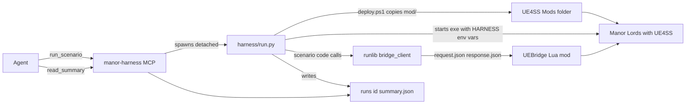

# System overview

This repo is an agent harness for making and testing Manor Lords mods. The agent edits a mod, deploys it, runs the real game, reads the result, and repeats. The goal is a trustworthy pass, fail or crash with evidence in about 2 to 3 minutes ([spec 00](../../../openspec/changes/archive/2026-10-15-legacy-00-harness-overview/README.md)).

## The layers

| Layer | Folder | What it is |
| --- | --- | --- |
| Game mods | `mod/` | Lua mods for RE-UE4SS. They hook reflected UFunctions and read UObject properties. |
| Live control | `mod/UEBridge/`, `mcp/ue4ss_bridge/` | A Lua mod and an MCP server. The agent queries the running game through them. |
| Outer harness | `harness/` | Scripts that deploy the mod, start the game, run a scenario, collect results and write `runs/<id>/summary.json`. |
| Agent tools | `mcp/harness_tools/` | The MCP server `manor-harness`. It starts runs and reads their results. |

`.mcp.json` starts both MCP servers over stdio with `.venv\Scripts\python.exe`. The two servers are `ue4ss-bridge` (module `ue4ss_bridge`) and `manor-harness` (module `harness_tools`). See [UE4SS bridge](../integrations/ue4ss-bridge.md) and [Harness MCP tools](../integrations/harness-mcp-tools.md).

A fifth part sits on top: the Invasion Mod in `mod/InvasionMod/`. It is one Lua mod and one pak, made of features. Harness code must not name this mod or its features. See [Invasion Mod structure](invasion-mod.md).

## Data flow of one loop

1. The agent calls `run_scenario` on `manor-harness`. The tool starts `harness/run.py` as a detached process and returns a run id.
2. `run.py` runs the phases in order: `preflight`, `deploy`, `launch`, `boot`, `scenario`, `collect`, `teardown`. See [Scenario run](../workflows/scenario-run.md).
3. `deploy` runs `harness/deploy.ps1`. It copies `mod/` into the UE4SS `Mods` folder and checks every file hash.
4. `launch` starts `ManorLords-Win64-Shipping.exe` directly. It passes `HARNESS_RUN_DIR`, `HARNESS_AUTOBOOT` and `HARNESS_TEST_SAVE` through the environment. The mod `HarnessBoot` loads the save and pauses the game, then writes `ready.marker`.
5. The scenario is a Python module in `harness/scenarios/`. It reads and changes game state through `harness/runlib/bridge_client.py`, which calls the bridge. Mod logic is reached through named commands. See [Mod commands and state](../concepts/mod-commands-and-state.md).
6. The bridge protocol is two files. The client writes `request.json` atomically (`.tmp`, then rename) with a unique id. The Lua mod runs it on the game thread and writes `response.json`. The client matches the id and has a timeout.
7. `collect` and `teardown` always run. The summary has a verdict and exit code: 0 pass, 1 fail, 2 crash, 3 timeout, 4 harness error. See [Run folder and verdicts](../concepts/run-folder-and-verdicts.md).
8. The agent calls `wait_for_run` and `read_summary`. It opens logs or screenshots only if the summary says so.

## Test layers

The agent uses the fastest layer that can answer its question (spec 00).

| Layer | What it checks | How |
| --- | --- | --- |
| 0 Syntax | Lua files compile | `harness/tests/lua_syntax.py` |
| 1 Mock | Mod logic against a fake game API | [Fake game kit](../testing/fake-game-kit.md) |
| 2 Live probe | Read and call things in the running game | The `ue4ss-bridge` tools |
| 3 Scenario run | Cold start, load save, scenario, collect | `harness/run.py` |
| 4 Regression suite | Many scenarios, baselines, A/B | [Suites and A/B](../workflows/suites-and-ab.md) |
| 5 Human | Look and feel, balance, final review | The user |

## Rules that hold everywhere

- Touch UObjects only on the game thread. The bridge Lua mod and the mods queue work with `ExecuteInGameThread`.
- Write files atomically. Use unique request ids and timeouts. Each run gets a new bridge folder, `runs/<id>/bridge/` (`harness/runlib/runfolder.py`).
- The simulation is not deterministic. Assert ranges, not exact values. Use A/B runs for stochastic behavior.
- A game crash is a result with logs. It is not a harness failure.
- Localhost only, single-player only, and a cap on iterations (`runs/.iterations`, default 400).
- Never call a game save function from a probe, a scenario or `eval_lua`. See [Safety rules](../concepts/safety-rules.md).
- Mods and scenarios must not depend on raw Lua eval (`eval_lua`). The bridge registers that tool only when `UE4SS_BRIDGE_ALLOW_EVAL=1`. Mods use named commands.

## Where to go next

- Folder by folder: [Source map](source-map.md).
- How specs, notes and branches work: [Specs, docs and project process](../operations/docs-and-specs.md).
