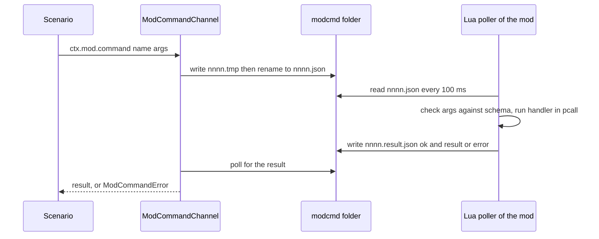

# Mod commands and state

A scenario (Python) cannot pass game objects through the bridge. So it sends named commands to Lua mods. A mod answers with a JSON result. Two channels exist. They share one file protocol. Scenarios must not use eval (`mcp__ue4ss-bridge__eval_lua`).

## Two channels

| | HarnessActions channel | Mod command channel |
|---|---|---|
| Lua side | `mod/HarnessActions/Scripts/main.lua` (fixed command list) | `mod/shared/HarnessCommands/HarnessCommands.lua` (any mod registers) |
| Python side | `CommandChannel` in `harness/runlib/commands.py` | `ModCommandChannel` in the same file |
| Request file | `<run>/commands/<nnnn>.json` | `<run>/modcmd/<Mod>/<nnnn>.json` |
| Answer file | `<nnnn>.result.json` | `<nnnn>.result.json` |
| Scenario API | `ctx.actions`, `ctx.commands.send` | `ctx.mod` (class `ModState` in `runlib/modstate.py`) |

Both are built in `ScenarioContext` (`harness/runlib/scenario_context.py`): `ctx.commands`, `ctx.actions`, `ctx.mod_commands`, `ctx.mod`.

Common protocol rules:
- Numbers are `0001`, `0002`, ... in order. UE4SS Lua cannot list a folder, so the mod waits for the next number.
- Both sides write `.tmp` first, then rename. A reader never sees half a file.
- The client waits at most 10 s (`ANSWER_TIMEOUT_S`) and polls every 0.1 s. It checks that the game is alive on each poll.
- The Lua handler runs on the game thread inside `pcall`.
- The run folder comes from `HARNESS_RUN_DIR`. Without it, the Lua poller does not start.



## HarnessActions

`HarnessActions` is the base-game helper mod. Its header comment in `main.lua` lists every request shape. The Python class `Actions` (`harness/runlib/actions.py`) wraps the commands. Each action does four steps: check the game world is loaded, read the state, change it, read it again. It returns `{action, ok, args, before, after}`, adds a short note, and records a failed assertion when the read-back fails. `NOT_POSSIBLE` lists actions that were found not possible (with the reason). An unknown name raises `ActionNotPossible`.

Use actions while the game is paused. A running game changes silver and stock by itself.

Unsafe spike commands (for example `master_part_add`, `master_artisan_set`, `building_stat_vector_write`) are refused unless the game runs with `HARNESS_ALLOW_UNSAFE=1`. Use that only in test games, never on a user save.

The catalog of commands is `openspec/changes/archive/2026-10-15-legacy-07-feature-test-kit/implementation-notes/actions-catalog.md`. Tests: `harness/tests/test_fakegame_harnessactions.py`, `test_runlib_actions.py`.

## HarnessCommands: a mod exposes its own commands

Why each mod serves its own commands: UE4SS gives every Lua mod its own Lua state. A shared module is loaded again in each mod, so tables and functions do not cross between mods. Files do. So the first `register` or `metric` call in a state starts a 100 ms poller in that state.

```lua
local commands = (require("HarnessCommands"))   -- parentheses: require returns two values
commands.register("MyMod.reset", function(args) return {ok = true} end,
                  { count = { type = "integer", required = true, min = 1, max = 100 } })
commands.metric("MyMod.captives", function() return state.captives end)
```

Rules (from the module header):
- A name is `<Mod>.<command>`: letters, digits and underscore, a letter first. `harness.*` is reserved. A duplicate is refused.
- The poller of mod X runs only `X.*` commands and the built-in `harness.list_commands` and `harness.metrics`.
- The schema lists every allowed argument. Types: `number`, `integer`, `string`, `boolean`. Rule keys: `type`, `required`, `min`, `max`, `maxLength`, `oneOf`. Unknown, missing or wrongly typed arguments are refused before the handler runs. A string has a default limit of 64 characters.
- A handler returns a JSON value, or `nil, "message"` to refuse on purpose. A handler slower than 50 ms is logged, not stopped.
- Requests are decoded as data by `HarnessJson.decode`. There is no eval.
- Hot reload: each poller writes a random token to `<Mod>/owner.txt` and stops when the file holds another token. This guards against a poller of an old Lua state.
- Player-safe mods (the Invasion Mod) load it with `pcall(require, "HarnessCommands")`, so the test commands exist only when the harness is present.

Test: `harness/tests/test_fakegame_harnesscommands.py`.

## Scenario API: `ctx.mod`

```python
ctx.mod.command("MyMod.capture", count=5)        # result; raises ModCommandError (mod refused) or ModDidNotAnswer
ctx.mod.refusal("MyMod.free_captives", count=10) # refusal text, or None if the mod accepted (the command still ran)
ctx.mod.metric("MyMod.captives", None)           # current value; default avoids ModMetricError
ctx.mod.wait_metric("MyMod.captives", lambda v: v == 0, timeout_s=20)
ctx.mod.commands("MyMod")                        # registered commands with their argument rules
ctx.mod.metrics_window(["MyMod.captives"])       # rows of metric reads made so far
```

- `ModState.command` checks the name rule `<Mod>.<name>` (`check_name`), calls `ensure_alive`, and sends. A refusal becomes `ModCommandError`. A missing folder or answer raises `ModDidNotAnswer` ("mod did not answer: X"). That means the mod is not loaded or has no poller. Look for its `loaded version` line in `mod.log`.
- A metric is read from the mod when you ask (one round trip, about 0.1 s). It uses `harness.metrics`. A failing metric function shows in the error text.
- `metrics_window` has no mod-side history. A row exists only when the scenario read the metrics.
- The channel continues after the highest request number already in the folder, so a second client never reuses a number.

Tests: `test_runlib_modstate.py`, `modstate_support.py`.

## ModState (Lua): values inside a save

Do not confuse it with the Python class of the same name. The Lua module `mod/shared/ModState/ModState.lua` keeps mod values in the `Tags` array of a game object (the player pawn). The game saves and loads that array, so values follow the save (spec 24 option A, mod feature M01).

```lua
local state = ModState.open("invasion", "pawn", 1)  -- same state table for the same mod and owner
state:register("raid_days", 400, "integer")          -- kinds: integer, number, boolean, string
state:get("raid_days"); state:set("raid_days", 399)  -- set flushes at once
```

- Entry format: Name `<mod>:<key>=<value>`. The version entry is `<mod>:v=<n>`.
- Only entries with the prefix `<mod>:` are read or written. Other Tags are never touched.
- An entry is changed in place. The module never removes an element (a removal is not proven safe).
- An unregistered key makes `get` and `set` fail with a clear message. Unknown prefixed entries are kept and listed in `dump().unknown`.
- Strings may use only `A-Z a-z 0-9 _ . -`.
- Safety: never write a `Tags` array through the bridge (crash). The module writes with `FName`. See [safety rules](safety-rules.md).

Limits (change `spike-mod-state-limits`, #283):

- One Tag name must be under 1024 chars. A longer name is not cut: the engine turns it into `ERROR_NAME_SIZE_EXCEEDED` at write time, and the content is lost.
- 1000 entries of 43 chars on the pawn survive a save and a load with the same text. Writing 1000 takes under 5 ms, a save grows about 3 KB, and no slowdown of save or boot was seen. Counts above 1000 were not tested.
- Tags on an AI lord and on a building survive a save and a load.
- A quick save and an autosave keep the pawn Tags, as a menu save does.
- A load restarts the game 10 minute autosave timer (the boot protection does not survive a load; #311). Run `disable_autosave` after a load.
- Test scenario `mod-state-tags-limits` (`mod/InvasionMod/scenarios/mod_state/tags_limits.py`, hidden) with the commands `tags_limit_write` and `tags_limit_read`. Its "lng" check fails on purpose.

Scenarios that save use a write run and a read run (`--save`, `--env MODSTATE_PHASE=read`). Test: `test_fakegame_modstate.py`. Notes: `openspec/changes/archive/2026-10-16-legacy-m01-mod-state/implementation-notes/tags-module.md`, `openspec/changes/archive/2026-10-15-legacy-24-mod-save-state/`.

## Where to extend

- New base-game command: add it in `mod/HarnessActions/Scripts/main.lua` (or a shared `Harness*` module that it calls), add the Python wrapper in `actions.py`, update the catalog. See [shared Lua modules](../architecture/shared-lua-modules.md).
- New mod command or metric: call `HarnessCommands.register` or `.metric` in the mod. No Python change is needed. Feature mods of the Invasion Mod do this; see [Invasion features](../architecture/invasion-features.md).
- Use the skill `harness-mod-state` for the full recipe. See also [UE4SS bridge](../integrations/ue4ss-bridge.md) and [writing scenarios](../workflows/writing-scenarios.md).
- Cross-mod Lua tests must use `FakeGame(separate_states=True)`. A test that passes only in one shared state proves nothing.
