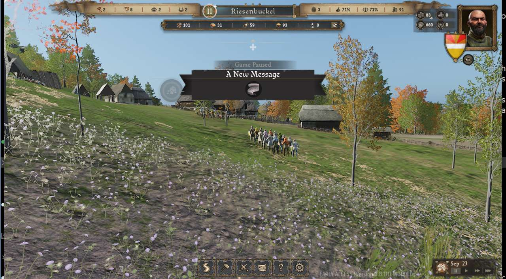
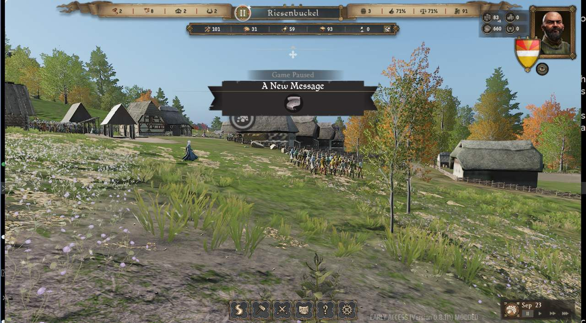
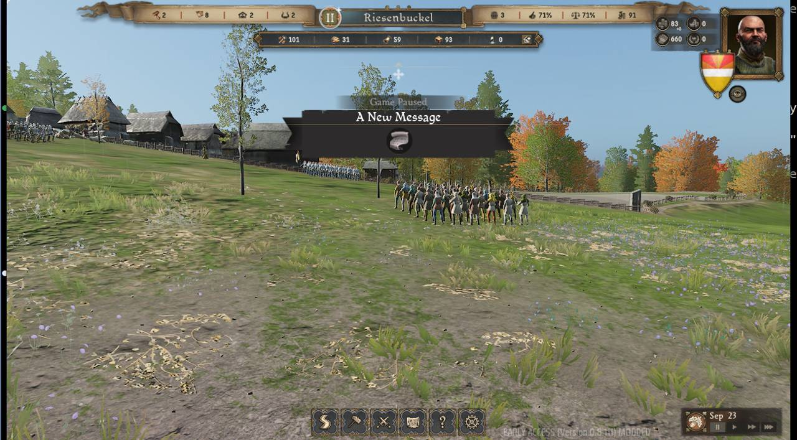
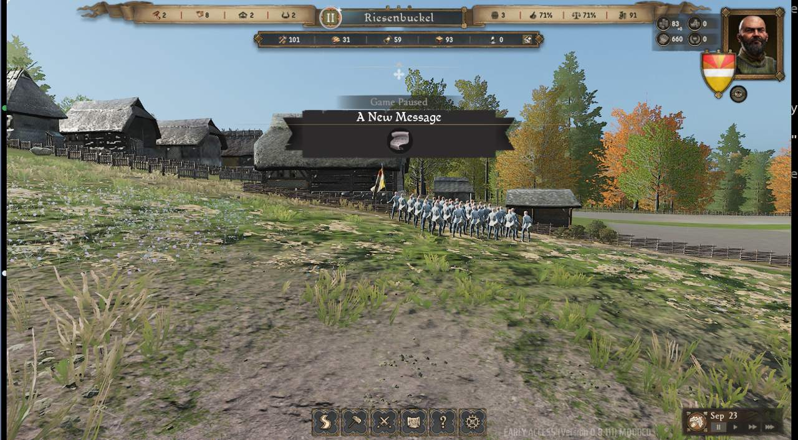
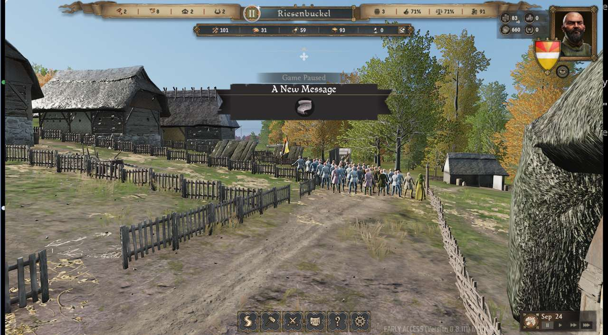

# Unit templates of the game

The game keeps its unit types as rows of the data table `DT_UnitTemplates` (`/Game/NotStronghold/Data/DT_UnitTemplates`). Read on 2026-10-22 from the extracted table (`modtools/work/json/ManorLords/Content/NotStronghold/Data/DT_UnitTemplates.json`, not in git). The extract may be from an older game version.

## Unit types

The row name is the id that code and pak mods use. "Max size" is the field `maxSize`, the largest squad of that type.

**Militia** (raised from villagers):

| Row | Unit | Max size |
|---|---|---|
| `spearMilitia` | Spear militia | 32 |
| `militiaPole` | Polearm militia | 32 |
| `militiaFoot` | Foot militia | 32 |
| `bowMilitia` | Bow militia | 32 |
| `crossbowMilitia` | Crossbow militia | 32 |
| `militia` | Peasant Militia | 32 |

**Retinue** (the lord's own troops):

| Row | Unit | Max size |
|---|---|---|
| `retinue_tier1` | Retinue, tier 1 | 60 |
| `retinue_tier3` | Retinue, tier 3 | 60 |
| `reginaldsRetinue` | Retinue of the AI lord Reginald (tier 1 template) | 60 |

**Mercenaries** (hired companies):

| Row | Unit | Max size |
|---|---|---|
| `mercenary_spearmen` | Spearmen | 60 |
| `mercenary_infantry` | Infantry | 60 |
| `mercenary_archers` | Archers | 60 |
| `mercenary_heavy_archers` | Heavy archers | 60 |
| `mercenary_crossbowmen` | Crossbowmen | 60 |

**Bandits:**

| Row | Unit | Max size |
|---|---|---|
| `brigands` | Brigands | 60 |
| `brigandArchers` | Brigand archers | 60 |
| `brigandPolearms` | Brigand polearms | 60 |
| `basket` | Basketmen | 60 |
| `sherwoodBow` | Sherwood Bowmen | 60 |

Not real units: `wrong_unit_type`, `single` ("single guy for testing", max size 1), `militiaFoot_testing`, `spearMilitiaTesting`, `brigands_old`, `retinue_tier1_old`, and the rows named `--------------------------` (dividers).

The table also has a `cost` field (25 or 100 for most rows). Its meaning is not known.

## Equipment

Equipment of the lord, mercenary and bandit types, from the project owner (2026-10-22). A percent is the share of the squad with that kit.

| Row | Equipment |
|---|---|
| `retinue_tier1` | 75%: shield, sword, chainmail, helmet, gambeson. 25%: polearm, chainmail, helmet, gambeson |
| `retinue_tier3` | 75%: shield, sword, chainmail, plate armor, helmet, gambeson. 25%: polearm, gambeson, chainmail, plate armor, helmet |
| `mercenary_spearmen` | large shield, spear, chainmail, gambeson |
| `mercenary_infantry` | shield, sword, chainmail, gambeson |
| `mercenary_archers` | bow |
| `mercenary_heavy_archers` | bow, gambeson, chainmail |
| `mercenary_crossbowmen` | crossbow |
| `brigands` | 75%: sword, shield. 25%: sword |

## Spawned in the real game

The probe scenario `probe-unit-gallery` spawned one squad of every type above with `spawnArmy` (the squads belong to the player side, so they stand still). The rule `unit_balance` was off, so the stats are vanilla. All 18 types spawned. Run 20261022-025232-2052. The table has the units in the squad, the mean attack, defense and armor pierce of its units, and the answer of `SMUnit:GetEquippedID` for slots 0 to 3 for the first four units (one unit is `slot0/slot1/slot2/slot3`, the numbers are item ids). The ids are not decoded yet.

| Row | Units in a squad | Attack | Defense | Armor pierce | Equipped ids (4 units) | Run |
|---|---|---|---|---|---|---|
| `spearMilitia` | 32 | 4.031 | 6.813 | 0 | 52/312/157/273; 163/133/271/273; 163/133/271/273; 52/133/271/273 | 20261022-025232-2052 |
| `militiaPole` | 32 | 5 | 2.875 | 1.938 | 52/312/157/273; 163/178/0/273; 163/178/0/273; 52/178/0/273 | 20261022-025232-2052 |
| `militiaFoot` | 32 | 5 | 4.75 | 0 | 52/312/157/273; 163/177/270/273; 52/177/270/273; 163/177/270/273 | 20261022-025232-2052 |
| `bowMilitia` | 32 | 3.063 | 2 | 0 | 52/312/157/285; 52/0/205/285; 52/0/205/285; 52/0/205/285 | 20261022-025232-2052 |
| `crossbowMilitia` | 32 | 3.063 | 2 | 0 | 52/312/157/285; 52/0/206/285; 52/0/206/285; 52/0/206/285 | 20261022-025232-2052 |
| `militia` | 32 | 2.625 | 0 | 0 | 52/312/157/199; 238/158/0/246; 52/223/0/241; 239/158/0/239 | 20261022-025232-2052 |
| `retinue_tier1` | 36 | 6.806 | 13.667 | 0.833 | 164/312/157/276; 164/278/290/276; 164/278/290/276; 164/250/0/276 | 20261022-025232-2052 |
| `retinue_tier3` | 36 | 6.583 | 64 | 0.611 | 293/312/157/294; 293/250/0/294; 293/278/290/294; 293/278/290/294 | 20261022-025232-2052 |
| `mercenary_spearmen` | 36 | 4.028 | 7.889 | 0 | 163/312/157/289; 163/133/271/289; 163/133/271/289; 163/133/271/289 | 20261022-025232-2052 |
| `mercenary_infantry` | 36 | 5 | 5.944 | 0 | 163/312/157/289; 163/177/270/289; 163/177/270/289; 163/177/270/289 | 20261022-025232-2052 |
| `mercenary_archers` | 36 | 3.056 | 3.222 | 0 | 163/312/157/289; 163/0/205/289; 163/0/205/289; 163/0/205/289 | 20261022-025232-2052 |
| `mercenary_heavy_archers` | 36 | 3.056 | 7.556 | 0 | 164/312/157/289; 163/0/205/289; 163/0/205/289; 163/0/205/289 | 20261022-025232-2052 |
| `mercenary_crossbowmen` | 36 | 3.056 | 2.889 | 0 | 163/312/157/289; 163/0/206/289; 311/0/206/289; 311/0/206/289 | 20261022-025232-2052 |
| `brigands` | 18 | 2.778 | 3.556 | 0 | 163/177/270/288; 163/177/270/207; 163/177/270/288; 163/177/270/288 | 20261022-025232-2052 |
| `brigandArchers` | 36 | 3 | 4 | 0 | 163/0/205/207; 163/0/205/288; 163/0/205/207; 163/0/205/288 | 20261022-025232-2052 |
| `brigandPolearms` | 36 | 5 | 4 | 2 | 163/178/0/288; 163/178/0/207; 163/178/0/207; 163/178/0/288 | 20261022-025232-2052 |
| `basket` | 36 | 3.056 | 2 | 0 | 154/312/157/154; 154/34/0/154; 154/34/0/154; 154/34/0/154 | 20261022-025232-2052 |
| `sherwoodBow` | 36 | 3.056 | 2 | 0 | 129/312/157/130; 129/0/126/61; 52/0/126/61; 129/0/126/61 | 20261022-025232-2052 |

Militia squads have 32 units, the same as `maxSize`. The other types give 36 units (`brigands`: 18), less than their `maxSize` of 60. The mean stats change a little from spawn to spawn, because the gear is random per unit. For example `retinue_tier3` had a mean defense of 63.5 in run 20261017-221800-9e31 and 64 here. The Hussite raid spawns many of these types with `spawnArmy` (`mod/InvasionMod/Scripts/config.lua`, roles; test scenario `invasion-raid-composition`).

## Brigand variants

The five bandit types, in the game, one squad each. Runs 20261022-023444-42a5 (brigands, brigandArchers) and 20261022-025232-2052 (the others). The squads belong to the player side. The "A New Message" banner is a game message, not part of the units.

`brigands`, run 20261022-023444-42a5.

`brigandArchers`, run 20261022-023444-42a5.

`brigandPolearms`, run 20261022-025232-2052.

`basket`, run 20261022-025232-2052.

`sherwoodBow`, run 20261022-025232-2052.

## What this means for mods

- A native raid of the game uses only Brigands. The game has no Hussite unit. A Hussite raid of the Invasion Mod runs under the baron AI, so it can use the lord unit types (retinue, militia, mercenaries) and bring a mix of archers, spearmen and retinue (`mod/raid_behavior`, Purpose).
- `HarnessDataTable` reads and writes single number fields of `DT_UnitTemplates` rows at run time (memory only). Do not read a whole row struct: it crashes the game.
- A pak mod can add new rows to `DT_UnitTemplates` (proven in spec 29), so the mod can add unit types of its own. See [Pak mods](../workflows/pak-mods.md).
