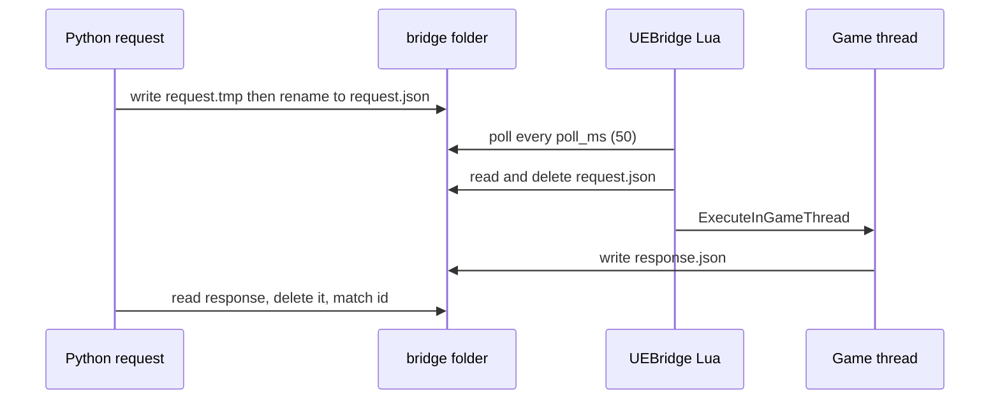

# UE4SS bridge

The bridge is the live control channel (spec 01). An agent or a scenario asks the running game a question, reads or sets a property, or calls a UFunction. No mod edit and no game restart is needed.
The code is vendored from upstream commit `a5eae1c` (`vendor/ue4ss-bridge/VERSION`). The harness patches are listed in `vendor/ue4ss-bridge/PATCHES.md`.

## Parts

| Part | Path | Job |
|---|---|---|
| Lua mod `UEBridge` | `mod/UEBridge/scripts/main.lua`, `settings.lua`, `json.lua` | Polls the request file in the game. Runs the request on the game thread. Writes the response. |
| Python server and client | `mcp/ue4ss_bridge/server.py` | MCP tools (stdio) and a CLI. The function `request()` is the file transport. |
| Scenario client | `harness/runlib/bridge_client.py` | Class `Bridge`: small helpers for scenarios (clock, pause, camera, HUD text). |

The folder name `UEBridge` is required. `harness/deploy.ps1` copies `mod/` into `ue4ss/Mods/`, so the mod deploys like every other mod (patch P3). The mod entry is `mod/UEBridge/mod.toml` (order 400).

## File protocol

The transport is two files in the bridge folder. There is no socket.

Rules in `request()`:
- Delete a stale `response.json` first.
- If `request.json` exists and is younger than `STALE_REQUEST_S` (10 s), fail with "still unconsumed". An older one is a leftover from a dead game and is deleted.
- Write `request.tmp`, then `os.replace` it to `request.json`. The body is `{"id": <12 hex chars>, "op": ..., ...}`. The id is unique per call.
- Poll for `response.json` every 50 ms until the timeout (`DEFAULT_TIMEOUT` 15 s). A response with another id is dropped and the wait continues.
- On timeout, the error says which case it was: never picked up (game not running, or the mod is not loaded), picked up but no answer (the game thread is blocked, for example in a loading screen), or the game died (the message holds a crash report from `crash_dir`).

Lua side (`main.lua`):
- A `LoopAsync(POLL_MS, ...)` loop reads the request. `ping` and `hello` answer at once. `batch` and `eval` run in `ExecuteInGameThread`. Every UObject access is on the game thread.
- `UEB.reload()` re-runs the file. A generation counter stops the old poll loop.
- The Lua `os.remove(REQUEST)` happens before the handler runs, so one request is never run twice.

Almost every MCP tool is one `batch` op with one call: `one(op, **args)` calls `batch([{"op": op, ...}])` and unwraps the entry. The tool `batch` sends several ops in one round trip (timeout 60 s). The ops are the `UEB.*` functions: `objects`, `types`, `subclasses`, `props`, `funcs`, `get`, `set`, `call`, `target`, `snapshot`, `diff`, `watch`, `hook`, `events`, `streams`, `unwatch`, `console`, `world`, `dump`, `reload`.

## Where the bridge folder is

The Lua mod uses `<HARNESS_RUN_DIR>/bridge` when that variable is set (patch P1). Otherwise it uses `settings.bridge_dir`, then `<ue4ss>/bridge`. The launcher sets `HARNESS_RUN_DIR` for the game (`build_game_environment` in `harness/runlib/game.py`), so each run has its own folder `runs/<id>/bridge`.

The Python side must point to the same folder. `configure_bridge_client` in `harness/runlib/scenario.py` does this for scenarios. It sets `UE4SS_BRIDGE_GAME_DIR` (the slot's `Win64` folder), `UE4SS_BRIDGE_DATA_DIR` (absolute `runs/<id>/bridge`) and `UE4SS_BRIDGE_GAME_PID`. The server caches its game location at first use, so the function also sets `server._GAME = None`. It then returns `Bridge(server.one)`.

## Environment variables

| Variable | Meaning |
|---|---|
| `UE4SS_BRIDGE_GAME_DIR` | The game root or any folder under it. `.mcp.json` sets it for the interactive server. |
| `UE4SS_BRIDGE_DATA_DIR` | The bridge folder. Unset for manual use: then it is `ue4ss/bridge` in the game folder. A run needs the absolute path `<HARNESS_RUN_DIR>/bridge`. |
| `UE4SS_BRIDGE_GAME_PID` | Optional. The "game is running" check then looks at that one process. With parallel slots the image name is shared and `tasklist` can time out under load. |
| `UE4SS_BRIDGE_ALLOW_EVAL` | Only `1` registers the `eval_lua` tool and the CLI verb `eval`. Leave it unset. |

Location order in `locate_game`: game dir argument or variable, then a running game process, then only the data dir. If nothing is found, it raises `BridgeError`.

## Eval gate and write gate

Raw Lua eval has two locks. Both must be open.
1. Python: `UE4SS_BRIDGE_ALLOW_EVAL=1` registers the tool (patch P2). The eval timeout is capped at 60 s (`MAX_EVAL_TIMEOUT`).
2. Lua: `allow_eval = true` in `mod/UEBridge/scripts/settings.lua` (patch P1, default `false`). `allow_writes = false` forces eval off.

CLAUDE.md approves `eval_lua` for single-player spikes. Mods and scenarios must not use it: they use named commands (see [Mod commands and state](../concepts/mod-commands-and-state.md)). `set`, `call` and `dump` need `allow_writes` (`dump` is gated by patch P6). Never use a save function through the bridge (see [Safety rules](../concepts/safety-rules.md)).

## Harness patches

Each patch is marked `PATCH P<n> (harness)` in the code. Search for it.

| Patch | Effect |
|---|---|
| P1 | `allow_eval` off by default. Bridge folder from `HARNESS_RUN_DIR`. Folder is created when missing. |
| P2 | Eval tool and CLI verb gated by the environment variable. Timeout cap 60 s. |
| P4 | `busy` clears after 120 s. A failed reply cannot leave it set. |
| P5 | List limits at most 500. A response over 1,000,000 bytes becomes an error. |
| P6 | `dump` needs `allow_writes`. |
| P7 | `mcp==1.30.0` pinned in `pyproject.toml`. Stdio only. |
| P8 | `get`, `set` and `call` refuse a name that is not a non-empty string. A nil name crashed the game. |

Known limit: a request can still run after the client timed out. After a timeout, read the state again.

## Servers in `.mcp.json`

`ue4ss-bridge` starts `.venv\Scripts\python.exe -m ue4ss_bridge` with `PYTHONPATH=mcp`. Run it from the repo root: the paths are relative. Use stdio only, not `--http`. Do not run `mcp/ue4ss_bridge/__main__.py` directly (relative imports). By hand: `$env:PYTHONPATH = "mcp"; uv run python -m ue4ss_bridge`. The other server, `manor-harness`, is in [Harness MCP tools](harness-mcp-tools.md). `.claude/settings.json` allows both servers.

## Failure behavior

- Bridge failures are results (`BridgeError` text), not harness crashes.
- A game crash gives a crash report text, taken from the crash folder after the request start time.
- The mod logs `[UEBridge] ... ready` to `UE4SS.log` at start. Check it if requests are never picked up.
- Hot reload of the bridge: the `reload_mod` tool.

## Tests

`Bridge` takes `one` and `sleep` as parameters, so tests can pass fakes. The Lua side has no unit test: it is checked in the game. Smoke results: `docs/harness/01-ue4ss-bridge/implementation-notes/smoke-test-log.md`.

## Extend

- New Python helper for scenarios: add a method to `Bridge` in `harness/runlib/bridge_client.py`.
- New bridge op: add a `UEB.<op>` function in `main.lua`, then a tool in `build_server`. Mark harness changes with a `PATCH` comment and add them to `PATCHES.md`.
