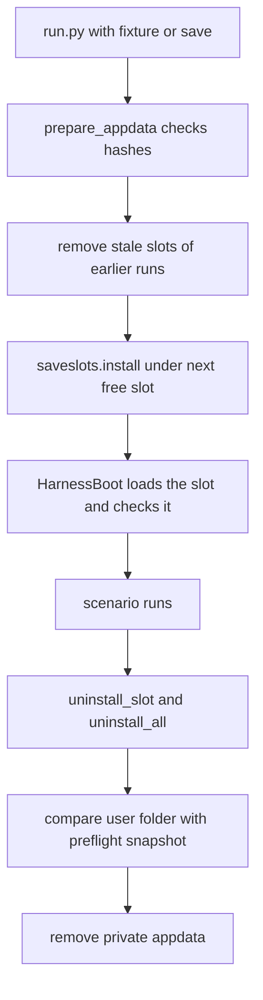

# Dev loop and fixtures

Spec 06. Two jobs: change Lua code and see it in the running game in about 2 s, and start every run from a known save.

## Hot reload

Entry point: `uv run python harness/tools/reload_mods.py [--mod Name ...] [--run-dir DIR] [--no-deploy]`.

Flow:
1. Run `harness/deploy.ps1`. It prints one `copied <path>` line for each changed file. The tool fails if the output does not show `errors: 0`.
2. `mods_to_reload` maps the copied files to mods. A change in `shared/<Name>` restarts every mod that uses that shared module (`mods_that_use_shared`).
3. For each mod, write `<run>/reload.json` (`{mod, id}`) atomically. The run folder is found from `HARNESS_RUN_DIR` in the environment of the game process, or given with `--run-dir`.
4. The Lua mod `HarnessReload` polls the file every 200 ms, deletes it, checks that `Mods/<name>/Scripts/main.lua` exists, and calls `RestartMod(name)` on the game thread. It waits up to 20 s for the line `[Name] loaded version <v>` in `mod.log`. Then it writes `reload.result.json` with `{id, mod, ok, version, line, error, seconds}`.
5. The tool compares the reported version with `local VERSION = "..."` in the repo file. A mismatch is a failed reload.

Exit code: 0 all reloaded, 1 a reload failed, 2 harness error (no game, no deploy, bad arguments).

Rules:
- A mod must log `loaded version <v>` through `HarnessLog` (tag = folder name), or the reload cannot be confirmed.
- `RestartMod` gives the mod a new Lua state. Old hooks and loops are gone. No double hooks were seen after more than 10 reloads.
- `HarnessReload` and `HarnessBoot` are not restarted by default (`NOT_BY_DEFAULT`). Restarting `HarnessBoot` would load the save again. Use `--mod` to force it.
- UE4SS `RestartMod` does not fail for an unknown name. That is why the mod and the tool check the folder.
- Bump `VERSION` in the mod when you change it. Without a change the version check cannot tell old code from new code.
- A syntax error appears in `UE4SS.log` (`Error loading script`), not in `mod.log`. The game keeps running. The next good deploy loads the mod again.
- Measured: 2.1 to 2.3 s from tool start to new code. UE4SS auto reload can restart only one of two changed mods, so the tool restarts each one itself. See `implementation-notes/hot-reload.md` in the spec folder.

Tests: `harness/tests/test_fakegame_harnessreload.py` (Lua side), `test_reload_mods.py` (tool).

## Fixtures

A fixture is one saved game. The manifest `harness/fixtures/fixtures.json` lists it: description, origin, SHA-256 of each file, `stored`, tags. The save files are in `harness/fixtures/saves/<name>/` under the stem `slot`. Git ignores that folder. Only the manifest is in git. The default fixture is `base` (`DEFAULT_FIXTURE`, a copy of the user's `saveGame_0` on Jagged_Cliffs). An old entry with `source_slot` and no stored files loads that slot of the user's folder by name, read only.

Why an install step exists: the game lists and loads saves only from the user's REAL save folder, and only names `saveGame_<n>` up to the highest number there. The slot name comes from the `saveSlot` value inside `<slot>_descr.sav`, not from the file name. A copy in the private `LOCALAPPDATA` is never read. Notes: `fixture-load-bug.md`.

Steps in the launcher (`harness/runlib/phases.py`, `harness/runlib/fixtures.py`, `harness/runlib/saveslots.py`):
1. `fixtures.prepare_appdata` builds the private `appdata` folder (copies the user's `Config`), checks the fixture files against the manifest hashes, and reads the user's folder under `fixtures.guarded`.
2. `_remove_stale_slots` removes slots that an earlier run left (for example `--keep-open`), using the ledger.
3. `_choose_slot` calls `saveslots.install`: copy the files to `saveGame_<max+1>`, rewrite `saveSlot` and `saveName` (`harness <label>`) in the descriptor, write the ledger first, then each file with its hash. It never overwrites.
4. `HarnessBoot` gets the slot in `HARNESS_TEST_SAVE`, loads it through the menu and checks that the loaded slot is the wanted one. See [scenario run](scenario-run.md).
5. At the end, `_finish_appdata` uninstalls the slot (only files whose hash still matches), compares the user's folder with the preflight snapshot and deletes the appdata. See [safety rules](../concepts/safety-rules.md).

### Choosing the start

`harness/run.py` options:
- `--fixture NAME` (default `base`): a fixture from the manifest.
- `--save PATH.sav`: any save file (its `_descr.sav` must be next to it). Installed like a stored fixture and removed at the end.
- `--new-game [--map Name]`: a fresh game with no save (spec 06 part E, default map `Jagged_Cliffs`). Nothing is installed. `HarnessBoot` gets `HARNESS_NEW_GAME=1`, opens the map, pushes the autosave away and pauses. Not allowed with `--save` or `--fixture`.
- `--keep-open`: leave the game running after the scenario.

### Tools

| Command | Use |
|---|---|
| `uv run python harness/tools/fixtures.py list` | list fixtures |
| `... fixtures.py import NAME --source-slot saveGame_28 --description "..." --tags a,b` | store a save of the user's folder as a fixture |
| `... fixtures.py import NAME --from D:\saves\saveGame_5.sav --description "..."` | store a save file |
| `... fixtures.py record NAME --source-slot saveGame_0` | old kind, no stored files |
| `... fixtures.py uninstall` | remove slots a run left (ledger files with a matching hash only) |
| `... fixtures.py remove --appdata DIR` | delete a run's private appdata (DIR must be named `appdata`) |
| `uv run python harness/tools/load_save.py NAME` | start the game with a fixture and leave it open and paused |
| `... load_save.py D:/saves/saveGame_5.sav` | same, for a save file |
| `... load_save.py --new-game [--map M]` | fresh game, left open |

`load_save.py` runs `run.py --scenario noop --keep-open` with `--fixture`, `--save` or `--new-game`. Extra arguments pass through (for example `--run-id NAME`). Close the game with the `stop_game` MCP tool or `harness/game-close.ps1 -Slot <n>`. The next run removes the installed slot, or run `fixtures.py uninstall`. Exit codes of `fixtures.py`: 0 done, 1 fixture or slot error, 3 a file in the user's folder changed during a read.

### Make a new fixture

1. Get a save: the user saves it by hand, or a scenario calls `ctx.actions.save_game(label, keep=True)` (guarded, see [safety rules](../concepts/safety-rules.md)).
2. `fixtures.py import NAME ...` copies the files to `harness/fixtures/saves/NAME/` and writes the manifest entry. A name uses letters, digits and `-`.
3. Only the manifest entry can go into git, because `harness/fixtures/saves/` is git-ignored. Say what the save holds in its `description`.

### Rules

- The code only reads the user's save folder, except for the guarded install, uninstall and `save_game`.
- The code deletes only a folder named `appdata` that holds `ManorLords/Saved`, and never the user's folder.
- Parallel runs share the save folder and the ledger (`SHARED_RUNS/.installed-slots.json`). Every change goes through `saveslots.saves_lock()`.
- Fixture files are checked by hash before use. A mismatch fails loud.

Tests: `test_runlib_fixtures.py`, `test_runlib_saveslots.py`, `saveslot_support.py`. Run all: `uv run python -m unittest discover -s harness/tests`.
