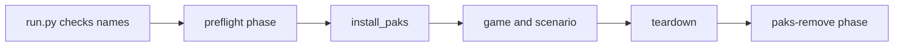

# Pak mods

A pak mod changes game data that Lua cannot change at run time: new rows, text, strings, soft objects and tables Lua cannot reach. Try Lua first (`datatable_write` can set number fields of the item table). Specs: [09 asset mods](../../../openspec/changes/archive/2026-10-15-legacy-09-asset-mods/README.md) and [22 mod pack layout](../../../openspec/changes/archive/2026-10-15-legacy-22-mod-pack-layout/README.md).

## What a pak is here
- The game paks are encrypted. The harness only reads them.
- A pak that the harness builds is unencrypted. It is named `<name>_P.pak` and goes to `Paks/~mods/`. The game loads it after the base paks, so its assets replace the originals.
- A data table is a `.uasset` plus `.uexp`. A pak replaces the whole file. If two paks change one table, only one wins and no error appears. This is why the Invasion Mod ships one pak (see [Invasion Mod structure](../architecture/invasion-mod.md)).

## Tools and config
`harness/tools/pakmod.py` is the command line. It drives two external tools:
- repak (list, get, pack) for pak files.
- UAssetGUI (`tojson`, `fromjson`) to turn an asset into JSON and back.

Config is `harness/pakmod.local.json` (git-ignored; an example is `harness/pakmod.local.example.json`). `load_config` reads: tool paths with optional SHA-256 pins, `usmap`, `usmap_name`, `engine_version` (`VER_UE5_5`), `work_dir`, `pak_version` (default `V11`), `mount_point` (default `../../../`), `aes_key_env` and optional argument `templates`. `pakmod.py check [--pin]` verifies the tools against the pins (exit 3 on a hash mismatch). In a worktree, copy the file from the main checkout.

UAssetGUI 1.1.0 ignores a mapping path. The `.usmap` must be a file in `%LOCALAPPDATA%\UAssetGUI\Mappings\<usmap_name>.usmap`. `check` reports a missing mapping. Make the mapping again after a game update.

### AES key rule
- The key opens the game paks. It is given to repak only through the environment variable named by `aes_key_env` (`MANORLORDS_AES_KEY`). `aes_key_args` fails loudly when the variable is not set.
- `redact` replaces the key with `***` in tool output.
- The key must never be printed, written to a note, a commit, a changelog, a PR or chat. The key file is in `modtools/work/` (git-ignored). Before a commit that adds a pak, grep the diff for the key. The release scan also checks (see [Mod releases](releases.md)).

## Commands
`uv run python harness/tools/pakmod.py <command>`. Exit codes: 0 ok, 1 error, 3 tool hash mismatch, 4 built pak list differs from the folder (`PakListMismatch`).

| Command | Job |
|---|---|
| `check [--pin]` | Check config, tools, hashes, mapping. |
| `find <text>` | Search the pak indexes. Indexes are cached in `work_dir/.index-cache`. |
| `extract <asset>` | `locate_asset` finds the pak (the last one by name wins) and `repak get` writes the files to `work_dir/extracted/`. |
| `tojson` / `fromjson <json> [--to <name>]` | UAssetGUI conversion. `--to` writes the asset into the build folder `work_dir/<name>/`. |
| `roundtrip <asset>` | Convert to JSON and back and compare bytes. Run it before editing a table. |
| `build <name>` | Pack `work_dir/<name>/` to `work_dir/out/<name>_P.pak`. Then list the pak and compare with the folder. |
| `install <name>` / `remove <name>` / `remove --all` / `list` | Manage the `~mods` folder. |
| `buildmod <ModName>` | Build the mod pak from row patches (below). |

All commands take `--dry-run` (global option, before the command).

## Hand workflow
1. `check`, then `roundtrip` on the table.
2. Edit the JSON (`Exports[0].Table.Data`). Helpers: `harness/tools/s65_edit_json.py` (stats, blueprint, visible) and `harness/tools/clone_table_row.py` (clone a row with `--set` and `--array`).
3. `fromjson <absolute json path> --to <name>`, move the files to the full game path inside the build folder when needed, then `build <name>`.
4. Run with the pak (below). Test A with the pak and B without it. Without the pak the same expectation must fail.

Traps: UAssetGUI exits 0 on errors. A missing mapping gives a useless "RawExport" JSON that still round-trips, and `tojson` now fails on it. Only number fields in one table are fully proven. New rows in `DT_UnitTemplates` and `DT_Items` are proven (spec 29). Test strings and other tables with a round trip first. Table names and paths: [game-data-tables note](../../../openspec/changes/archive/2026-10-15-legacy-10-invasion-testability/implementation-notes/game-data-tables.md). Raid logic is code, not a table.

## Running a scenario with a pak
`run.py --scenario <name> --pak <name>` (repeatable; `--pak-config` names the config). Flow:

- `run.py` checks each name with `paks.check_name` (1 to 40 of `A-Za-z0-9_-`, no duplicates) and reads `work_dir` through `work_dir_from_config`. `--pak` is refused with `--fake`.
- `install_paks` runs at the end of preflight. It records the name first, then copies `work_dir/out/<name>_P.pak` into `~mods` with `paks.install_pak`. The SHA-256 prefix goes to `config.json` under `environment.paks`.
- `install_pak` refuses to overwrite a file that is not in the manifest `~mods/.harness-paks.json`. The manifest lists the files the harness wrote, with their hash.
- `remove_paks_phase` (`paks-remove`, `always_run`) runs after teardown, so a crash or a timeout still removes the paks. It uses `remove_listed`, which ignores names not in the manifest. It never deletes a file that changed after install (it reports it). It fails the phase with a hint to run `pakmod.py remove --all`.
- A `--keep-open` run does not remove its paks. The game still runs and loads pak assets on demand (a widget on its first open); removing a pak under it hung the game on F9. The phase `paks-remove` then only adds a note. A later run with the same `--pak` replaces the file.
- After a run killed by a timeout, or when you are done with a `--keep-open` game, close the game, run `pakmod.py list`, and run `remove --all`.

## Invasion Mod pak (`buildmod`)
`pakmod.py buildmod InvasionMod` builds `mod/InvasionMod/paks/InvasionMod_P.pak` from the sources of all features. Logic is in `harness/tools/modpak.py` (pure, tools passed in as functions so tests need no game). The mod folder layout is in the [Invasion Mod structure](../architecture/invasion-mod.md) page.

Steps in `build_mod`:
1. `read_manifest` reads `mod.json`. `load_patches` reads `data/<feature>/patches/*.json` in feature order of `mod.json`, then by file name.
2. `check_conflicts` fails when two patches add the same row, or two features set the same field of one row. The message names both files.
3. `check_id_ranges` fails when a new row is outside the `ids` range of its feature in `mod.json` (`ids` maps a table to `[first, last]`).
4. For each used table, the current game table is extracted (`fetch`: `extract`, then `tojson`) - every build starts from the current game paks.
5. `apply_patches` edits the JSON. Then each table is written and packed with `fromjson`.
6. `copy_assets` copies `data/<feature>/assets/**` into the pak folder. Two features cannot write the same file. Symlinks are refused.
7. `build` packs the folder. The pak is copied to `mod/<ModName>/paks/`. The work folder is deleted at the start, so no stale file stays.

Patch format (keys: `table`, `row`, `op`, `from`, `set`):
```json
{ "table": "buildingStats", "row": "1000", "op": "add", "from": "97", "set": { "stableSpace": 4 } }
```
- `op` is `add` (clone row `from`, give it the new name, add the name to the `NameMap`) or `set` (change fields of an existing row). `remove` is not supported.
- Tables: `buildingStats` and `DT_Upgrades` (`TABLES` in `modpak.py`). Row ids are digit strings.
- A list value replaces an array field by copying its first element as a template. An empty array fails.
- Example patches: `mod/InvasionMod/data/example/patches/`. Notes: [buildmod.md](../../../openspec/changes/archive/2026-10-15-legacy-22-mod-pack-layout/implementation-notes/buildmod.md).

Note that the `mod.json` of the Invasion Mod names pak `raidmenu` with `source: file`, and `mod/InvasionMod/paks/` holds committed paks. See [Mod releases](releases.md).

## Rules
- Original game paks are read only. Do not commit them, extracts, `.usmap` files or `modtools/work`.
- Compiled mod paks (`*_P.pak`) may be committed, also with modified game data. A mod keeps its pak at `mod/<Name>/paks/<pak>_P.pak`. Grep the diff for the AES key before each commit.
- `check_mod_name` refuses the reserved work folders (`out`, `extracted`, `json`, `fromjson`, `roundtrip`, `.index-cache`).
- Paths are checked with `require_inside`: nothing may leave `work_dir`.
- Tool calls have timeouts (repak 300 s, UAssetGUI 120 s).

## Limit: no new backyard extension type
- A pak cannot add a new backyard (burgage plot) extension type. The type list `EExtensionType` is a native enum with 17 values (0 to 16). A new `DT_Upgrades` row 117 (key = 100 + type) loads, and the game accepts `Type` 17. But the plot gets 0 parts, no cost, no job and no production. Evidence: [new-extension-number.md](../../../openspec/changes/archive/2026-10-18-legacy-31-burgage-extension/implementation-notes/new-extension-number.md), runs `s31-ext17-1` and `s31-ext17-2`.
- A pak and Lua can only reuse an existing slot, for example the tailor (Type 6): Lua sets the job and the recipe after every load, and a pak model replaces the slot mesh. The old extension is lost.
- The weaver extension was not shipped (spike `spike-weaver-extension-shipping`, issue #230, closed 2026-10-19). A new job needs a stand-alone building (new `buildingStats` row) instead.

## Related kinds of pak
- Models in a pak: [Meshy models](meshy-models.md).
- Widget Blueprint pak (spec 16): cook with UE, copy the `.uasset` and `.uexp` into the build folder, then `build`. See `.claude/skills/harness-pak-mod/SKILL.md` and spec 16 notes.
- Composite buildings and a retargeted `blueprint` field: [composite-pak note](../../../openspec/changes/archive/2026-10-15-legacy-18-composite-buildings/implementation-notes/composite-pak.md).

## Composite buildings in a pak
Facts from spec 18 and the spike `spike-composite-building-gaps` (sources: [spec 18 README](../../../openspec/changes/archive/2026-10-15-legacy-18-composite-buildings/README.md) and its `implementation-notes/`).

- A composite building is one `SMBuildingMaster` with `SMBuilding` parts. The tent (type 87) and the bandit camp (type 100) are built this way.
- A pak can add a new building id (rows 123, 124, 125) with a new part list. A new `BM_*` Blueprint class made in UE 5.5.4 works. Part names must start with `MainBld_` or `Bld_`. A real mouse click places it.
- A new id has no build menu card (category, art, name text). A test with a pak that sets `bVisibleInUi` and a category was not run.
- The Siege Camp (row 483) shows in the Military tab with a pak and can be placed, but it never builds. It has no cost, no construction mesh, a placeholder construction Blueprint and no region. No call adds its master to a region. See `siege-camp-build.md` in the same notes folder.
- Large stable (row 125, pak `stable4`): `stableSpace` 4 gives `stableMax` 4 and 4 housed oxen. Ox hitch spots are native, so a larger shed adds none (`big-ox-shed-test.md`, `ox-hitch-hook.md`).
- Not known: why repeated oxen orders add only one ox, and where idle oxen stand.

Not done: the owner closed the change `spike-composite-building-gaps` without a build on 2026-10-19 (issue #104). The menu card, the Siege Camp build and the stable test scenario are not wanted for now.

## Tests
```
uv run python -m unittest discover -s harness/tests -p "test_pakmod.py"
uv run python -m unittest discover -s harness/tests -p "test_modpak.py"
```
They use fake tool scripts, so they need no game, no UAssetGUI and no key. Install and remove logic is covered by the pakmod tests.

## Rule: new row ids (spike #284)
- New `buildingStats` ids (126 to 65536) load, are placed, built, saved and loaded. An AI lord village does not crash on them (it ignores them).
- Do not add `DT_Upgrades` rows with new ids. The game copies the cost into `needs` but never carries out the upgrade (runs `rowid-control-b`, `-e`).
- Do not set `upgradesInto` to a new building id. The replaced building does not become the new type (run `rowid-control-f`).
- A vanilla upgrade id with the same fields works.
- Owner decision 2026-10-21: accept this limit. Evidence: `openspec/changes/archive/2026-10-21-spike-new-row-id-persistence/notes/id-persistence.md`.
