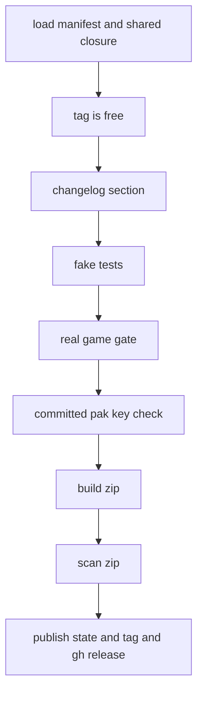

# Mod releases

`harness/release.py` turns one mod version into one zip for play testers and, on request, a GitHub pre-release. Rules: [spec 19](../../harness/19-mod-releases/README.md). Example mod: `mod/RefugeeWaves`.

## Entry point
```
uv run python harness/release.py --mod <Name> --dry-run
uv run python harness/release.py --mod <Name> --publish
```
Options: `--runs-root`, `--out-dir` (default `dist/`, git-ignored), `--pak-dir`, `--aes-key-file`, `--skip-tests`, `--offline`. `--dry-run` and `--publish` exclude each other. Without `--publish` nothing leaves the PC. Each failure prints `FAILED: <reason>` and exits 1.

## Check order (`release()`)

1. **Manifest** (`releaselib/manifest.py`, `load_manifest`). Required keys: `name`, `version`, `description`, `shared`, `tested` (`game`, `game_build`, `ue4ss`), `gate_scenarios`. Optional: `display_name`, `pak`, `features` (`name`, `requires`, `ids`). `pak` is `null`, `{name, source: "build"}` or `{name, source: "file", path}`. `gate_scenarios` may be empty only when `features` is set. The name must equal the folder name.
2. **Shared closure** (`files.shared_closure`). The mod may use only declared shared modules and what they require. A plain `require("X")` is a hard dependency. `pcall(require, "X")` is optional and does not count. A hard dependency on a harness-only module (`HARNESS_ONLY`: HarnessActions, HarnessBoot, HarnessLog, HarnessCommands, HarnessTelemetry, HarnessReload, HarnessAutosave, UEBridge, stand-ins and probes) fails. Fix: move the game call into `ManorCore` and let the Harness module call it.
3. **Tag** (`check_not_tagged`). The tag is `<name-lower>-v<version>`. It must not exist locally or on `origin`. `--offline` turns an unreachable origin into a warning.
4. **Changelog** (`changelog.release_notes`). `mod/<Name>/CHANGELOG.md` needs a non-empty `## [x.y.z] - date` section. That text becomes the release notes.
5. **Fake tests**. The full unittest discovery over `harness/tests` (`TEST_COMMAND`). `--skip-tests` is only for a quick look.
6. **Gate** (`releaselib/gate.py`). See below.
7. **Committed paks**. Each `mod/<Name>/paks/*.pak` is scanned for the AES key text. A pak over 10 MB (`PAK_SIZE_WARNING_BYTES`) gives a warning and a Git LFS hint. It does not fail.
8. **Zip** (`build.build_zip`) and **scan** (`scan.scan_zip`). A failed scan deletes the zip.
9. **Publish** (only with `--publish`). `check_publish_state` needs a clean tree and HEAD inside `origin/main`. Then `git tag`, `git push origin <tag>`, and `gh release create --prerelease` with the zip and the notes.

## The real-game gate
A release needs a passing real run of each `gate_scenarios` entry with the same mod files.
- Every real run writes `runs/<id>/mod_files.json` (SHA-256 of every file under `mod/`, from `_record_mod_files` and `hash_mod_files` during deploy). It names the file in `summary.environment.mod_files`. A fake run has none, so it never counts. See [Run folder and verdicts](../concepts/run-folder-and-verdicts.md).
- `current_hashes` hashes the files that a release would contain: the mod (without `data/` and `scenarios/`, the `NOT_RELEASED` folders) and its shared modules.
- `check_scenario` picks the latest passing run whose hashes all match, and whose `game_build` equals `tested.game_build`. Errors say which case failed and name the command to run: `uv run python harness/run.py --scenario <name>`. A "used other mod files" error lists the files that differ.
- Any later edit of a mod file or a used shared module closes the gate. Run the scenario again. Do not launch the game without the user's wish.

## The zip
Name `<Name>-v<version>.zip`. Game-folder layout:
- `ManorLords/Binaries/Win64/ue4ss/Mods/<Name>/` with `enabled.txt`. It leaves out `data/`, `scenarios/`, `paks/`, `ue/` and `art/`.
- `.../Mods/shared/<Module>/` for the shared closure.
- `ManorLords/Content/Paks/~mods/<pak>_P.pak` if the manifest has a pak. `source: file` takes `mod/<Name>/paks/<pak>_P.pak` (or `pak.path`). `source: build` takes it from `--pak-dir` (output of `pakmod.py build`). See [Pak mods](pak-mods.md).
- `README.txt` with install, uninstall and tested versions.
Files get a fixed date, so equal input gives equal bytes. The zip is written as `.tmp`, then renamed.

## Scan and the AES key
`scan_zip` fails on a harness-only module name in a path, a hard `require` of one in a `.lua` file, and the key text (plain, lower, upper, without `0x`, UTF-8 and UTF-16) in any file. The key comes from `--aes-key-file`, else `modtools/work/aes_key.txt` of the main checkout (`main_checkout` uses the git common dir, so a worktree finds it). A key shorter than 16 characters is rejected. The key is never printed. Do not read the file by hand.

## Rules and operations
- Releases come from committed files on `main`. Player mods never call a save function (CLAUDE.md Safety).
- In a worktree the key file is not there: pass `--aes-key-file` or run from the main checkout.
- Bump `version` in `mod.json` and add a changelog section for each new release. The Invasion Mod manifest has `gate_scenarios: []`, so its gate checks nothing (a warning prints).
- Extend the gate or the scan in `releaselib/`. Add a harness-only module to `HARNESS_ONLY` in `files.py`.

## Tests
```
uv run python -m unittest discover -s harness/tests -p "test_release_*.py"
```
No game is needed.
