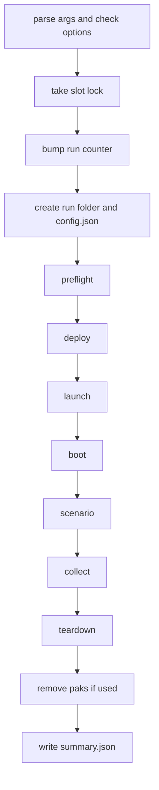

# Scenario run

`harness/run.py` runs one test iteration. It deploys the mods, starts the real game, waits until `HarnessBoot` says READY, runs one scenario, collects logs, stops the game, and writes `runs/<id>/summary.json`. The result is described in [Run folder and verdicts](../concepts/run-folder-and-verdicts.md). Spec: [03 run launcher](../../harness/03-run-launcher/README.md).

Start every Python command with `uv run python`:

```
uv run python harness\run.py --scenario smoke
uv run python harness\run.py --fake pass          # no game, fake phases
uv run python harness\run.py --list-scenarios
```

Exactly one of `--scenario` and `--fake` is required. How to write a scenario: [Writing scenarios](writing-scenarios.md).

## Control flow

`main` parses the arguments, then `run_one` does the steps below. Steps 1 to 3 fail before any run folder exists. They print `harness_error: <message>` to stderr and return exit code 4. No `summary.json` exists then.

1. `check_variant_options`: parses `--env`, checks `--pak` names, `--save`, `--new-game` and `--map`. `build_phases` runs once, so a wrong scenario name or fixture name fails early. An uninstalled `--slot` fails here too.
2. `take_slot_lock`: takes the run lock of the asked slot (`RunLock`, file `runs/.lock` for slot 0, `runs/.lock-<n>` for others). With `--slot auto` it takes the first free installed slot. A fake run uses slot 0 and no game slot. A lock of a dead process is taken over, and a note records it.
3. Inside the lock: `build_phases(args, slot)`, then `bump_iterations` (the run cap), then `create_run_folder`, `build_config`, `write_config`, and `execute_run`.
4. `execute_run` runs the phases and always writes `summary.json`, even when it raises.
5. `run_one` prints `<run_id> <verdict> reason=... summary=<path>` and returns `EXIT_CODES[verdict]`.



## Phases

`runlib/runner.py` runs each phase in a daemon worker thread with a time limit (`_run_with_limit`). A phase ends as `ok`, `failed` (it raised `PhaseFailed`), `error` (any other exception) or `timeout`. Python cannot kill a thread, so a timed out thread keeps running until its function returns. After the first bad phase the rest are `skipped`, except phases with `always_run` (collect and teardown). A `KeyboardInterrupt` does not skip those either. It is raised again at the end.

`build_real_phases` in `runlib/phases.py` builds the list. `LOCK_WAIT_S` is the wait for the shared saves lock, added to some limits.

| Phase | Limit | What it does |
|---|---|---|
| preflight | 60 s + lock wait | Records `run_started_epoch`. Notes if Steam is not running (a direct launch works). Needs `.venv/Scripts/python.exe` and the game exe. Stops a stale game of this slot only. Under the saves lock: removes slots an earlier run left, builds the private appdata, picks the save slot, gathers the environment (hashes), installs paks if `--pak` is set. |
| deploy | 120 s | Runs `harness/deploy.ps1 -GameDir <root>`. Needs exit code 0 and a `Summary: ... errors: 0` line. Writes the mod hashes into `config.json` and `mod_files.json`. |
| launch | 60 s + lock wait | Builds the game environment, takes the saves scan lock, starts the game exe with `cwd` = `Win64`, waits 3 s and checks it is alive. |
| boot | 240 s | Polls `boot.json` every second until READY or FAILED. Own deadline: `BOOT_DEADLINE_S` = 230. Then moves the window to the slot tile. |
| scenario | scenario `LIMIT_S` | Gets the bridge client, takes the `start` screenshot, runs the scenario function. Stores `scenario_result` and writes `scenario.json`. |
| collect | 60 s, always | `end` screenshot, copies `UE4SS.log`, crash reports and UE4SS dumps, lists the artifacts. |
| teardown | 30 s + lock wait, always | Sets `game_stop_requested`, stops the game, copies `UE4SS.log` again, stops orphan `CrashReportClient`, removes the installed slot and the private appdata. |
| remove paks | see `pak_phases.py` | Only with `--pak`. Runs after teardown, when the game no longer holds the pak. |

The default scenario limit is `DEFAULT_LIMIT_S` = 90 s. A limit above `LONG_LIMIT_S` (300 s) needs a written reason. The maximum is 13500 s (`runlib/scenario.py`).

### Preflight and the save

The game runs with a private `LOCALAPPDATA` (`runs/<id>/appdata`). The harness copies the needed save files into the user's real save folder under a free slot name, because the game loads from there (see [Safety rules](../concepts/safety-rules.md)). Before the run it snapshots the user's save files (`user_files`). Teardown removes the installed slot, compares the folder with the snapshot, and fails the phase with `the user's save files changed during the run` if they differ. See [Dev loop and fixtures](dev-loop-and-fixtures.md) for fixtures.

With `--keep-open` teardown skips the stop and the save comparison. It notes the left appdata and the commands to clean up.

### Launch and boot

`build_game_environment` sets these variables for the game process:

| Variable | Meaning |
|---|---|
| `HARNESS_RUN_DIR` | The run folder. All mod output goes here. |
| `HARNESS_AUTOBOOT` | `1`: `HarnessBoot` loads the save by itself. |
| `HARNESS_TEST_SAVE` | The save slot to load. |
| `HARNESS_NEW_GAME`, `HARNESS_NEW_GAME_MAP` | Set only with `--new-game` (default map `Jagged_Cliffs`). No save is loaded. |
| `HARNESS_TELEMETRY_INTERVAL_S` | Seconds between telemetry samples. `0` turns it off. |
| `LOCALAPPDATA` | The private appdata of the run. |
| `HARNESS_GAME_ARGS` | Optional game arguments. Only `-faketouches` and `-windowed` are allowed. |

`--env KEY=VALUE` adds extra variables. The harness values win. Names that start with `HARNESS_RUN_DIR`, `LOCALAPPDATA`, `PATH` or `UE4SS_BRIDGE` are refused (`runlib/extra_env.py`). `config.json` stores values masked, and `summary.json` only the key names.

`HarnessBoot` ([mod/HarnessBoot/](../../../mod/HarnessBoot/)) walks the states `WAITING_FOR_MENU`, `LOADING_SAVE`, `WAITING_FOR_READY`, `DISABLING_AUTOSAVE`, `PAUSING`, `READY`. Any wait can go to `FAILED`. READY means the game clock was measured as stopped. It also pushes the autosave timer far away before READY. It writes `boot.json` atomically. The boot phase stores `{state, seconds, pause_calls, reason}` as `boot` in the summary. The saves scan lock is held from launch until the boot leaves `WAITING_FOR_MENU` (at most 90 s), so two games do not read the save list while a run changes the folder.

### Crash detection

`ensure_game_alive` is called in launch, boot and scenario. If the game process ended and no stop was requested, it records `state["crash"]` with the exit code and raises `PhaseFailed`. The verdict is then `crash`. Scenario failures (`ScenarioFailure`, `ActionNotPossible`) become a failed scenario result, but a dead game is checked first.

## Rules that must hold

- One run per slot at a time (run lock). Parallel runs use different slots ([spec 11](../../harness/11-parallel-game-slots/README.md)). Locks, the run counter and the save ledger are shared by all git worktrees (`runlib/shared.py`).
- The run cap: `runs/.iterations` counts runs. Default 400. Set it with `--max-runs` or `HARNESS_MAX_RUNS`. A bad value is an error. At the cap the run fails before it starts. Delete the counter file to reset.
- The user's save files must not change during a run. Only the installed slot is added and removed. Any other change fails teardown.
- The simulation is not deterministic. Scenarios assert ranges.
- A crash is a result with logs, not a harness failure.
- Do not run unit tests while a real run is active: a test that calls the real stale game stop can end the game ([Debugging runs](../operations/debugging-runs.md)).

## Other options

`--fixture NAME` or `--save FILE` choose the start save. `--pak NAME` (repeatable) installs a built pak for the run and removes it at the end, see [Pak mods](pak-mods.md). `--telemetry-interval`, `--run-id`, `--runs-root`, `--keep-open`, `--slot N|auto`. `--fake <outcome>` uses `runlib/fake_phases.py`: no game, no pak, no env.

## Where to extend

- A new phase: add a `Phase(...)` in `build_real_phases` with a function over `PhaseContext`. Set `always_run` for cleanup.
- A new run option: add it in `parse_args`, check it in `check_variant_options`, record it in `build_config`.
- New facts for the summary go into `ctx.state` (`boot`, `scenario_result`, `crash`, `artifacts`, `notes`). `_build_summary` reads only those.

## Tests

`harness/tests/test_runlib_runner.py`, `test_runlib_phases.py`, `test_runlib_runfolder.py`, `test_runlib_summary.py`, `test_runlib_latecrash.py`. Run:

```
uv run python -m unittest discover -s harness/tests -p "test_runlib_*.py"
```

See [Python tests and coverage](../testing/python-tests.md). Run the real game with the skill `harness-run-scenario`.
