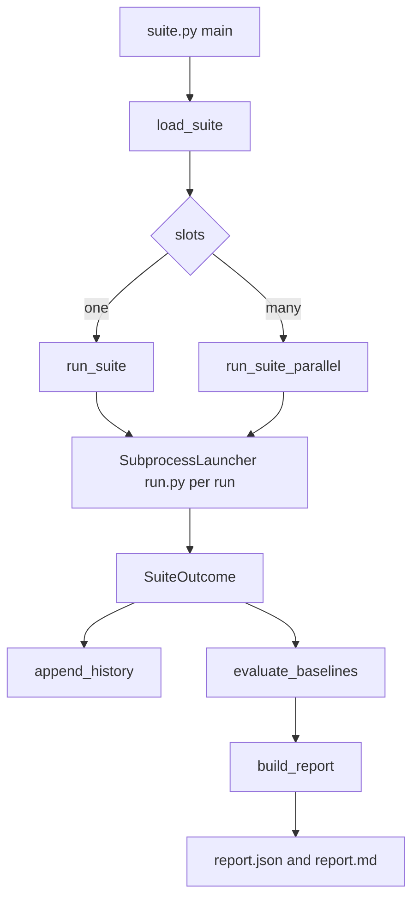

# Suites, baselines and A/B tests

One run proves little, because the simulation is not deterministic. A suite runs scenarios several times, compares them with baselines, and compares variants with statistics. Each run is one `run.py` process (see [Scenario run](scenario-run.md)). Scenarios record numbers with `ctx.metric` (see [Writing scenarios](writing-scenarios.md)).

## Entry points

| Command | Job |
|---|---|
| `uv run python harness\suite.py --suite <name> [--slots N\|all] [--max-minutes N] [--run-timeout-s S]` | Run `harness/suites/<name>.json`. Writes `runs/suite-<id>/report.json` and `report.md`. |
| `suite.py --list` | Print the suites. `x<n>` is repeat, `?` is optional, `[a/b]` are variants. |
| `suite.py --update-baseline <scenario> [--from-last N]` | Propose `harness/baselines/<scenario>.json` from the last N passing runs (default 5). |
| `uv run python harness\run_series.py --scenario <name> --runs N` | Run one scenario N times (1 to 20) and print a table. No suite file. |

Exit codes of `suite.py`: 0 pass, 1 fail, strict drift or missed A/B expectation, 2 unresolved crash or timeout, 3 budget or iteration cap ended the suite early, 4 harness error. `--launcher-command` or env `HARNESS_SUITE_LAUNCHER` replaces `run.py` (tests use this).

## Suite file

`suitelib/suitefile.py` validates the file. Unknown keys are errors. The file name must equal `name`.

```json
{"name": "raid-size-ab", "time_budget_s": 1500, "flake_retries": 0,
 "scenarios": [{"scenario": "raid-tiers", "repeat": 4,
   "variants": [{"name": "size-100", "env": {"RAID_STANDIN_SIZE_PERCENT": "100"}},
                {"name": "size-150", "env": {"RAID_STANDIN_SIZE_PERCENT": "150"}}]}]}
```

- Suite keys: `name`, `scenarios`, `time_budget_s` (above 0), `flake_retries` (0 or more).
- Entry keys: `scenario`, `repeat` (1 or more), `fixture`, `optional` (skipped, not failed, if the scenario does not exist), `variants`, `expect`.
- Variant keys: `name` (1 to 30 of `A-Za-z0-9_-`, unique), `paks` (checked by `runlib/paks`), `env` (text values, checked by `runlib/extra_env.check_env_entry`). Each becomes `--pak NAME` and `--env KEY=VALUE` for `run.py` (`launcher.variant_arguments`). Reserved env names are refused. See [Pak mods](pak-mods.md).
- `expect`: `metric`, `direction` (`lower` or `higher`), `min_rel_diff`. It needs at least two variants.

Examples: `core.json` (smoke, time-advance, telemetry-sanity), `ab-example.json` (an A/A style check on `smoke`), `raid-size-ab.json`, `counters-ab.json`, `pak-ab.json`, `soak.json`, `selftest.json`.

## Control flow



1. `run_suite` (`suitelib/runner.py`) loops over entries in order. Inside an entry it loops `repeat` times and, in each repeat, over the variants. So variants alternate (A, B, A, B). Slow drift of the machine hits all variants alike.
2. Each run gets the id `<suite_id>-<count>-<scenario>[-<variant>][-r<retry>]` and goes to the launcher with the scenario, fixture and variant.
3. `SubprocessLauncher` starts `run.py --scenario ... --run-id ... --runs-root ... [--fixture] [--pak] [--env] [--slot]`. It reads `runs/<id>/summary.json`, then adds `metrics.json` values (they win over summary values of the same name). The kill timer is `run_timeout_s(scenario)` unless `--run-timeout-s` is set. On timeout it kills the process tree and calls `close_game`.
4. A failed repeat retries up to `flake_retries` times for verdicts `fail`, `crash`, `timeout`. A `harness_error` is not retried. The last attempt decides the repeat. An entry with passes and failures is `flaky`.
5. The suite stops early at the time budget (the lower of `time_budget_s` and `--max-minutes`) or when `run.py` refuses a run with "Iteration limit" (the run cap). The report then says what was not run.
6. Unrun entries are listed in `not_run`. An unknown optional scenario gives a `skipped` entry.

### Parallel slots

`--slots N|all` uses the game slots installed by `harness/install.ps1` (see [Install and environment](../operations/install-and-environment.md)). `run_suite_parallel` (`suitelib/pool.py`) builds one job per repeat and variant in the sequential order, and gives jobs to free slots. A scenario with `EXCLUSIVE = True` waits until no other game runs. A slot whose run fails to start is marked bad. If every slot is bad, the suite stops with `no_slots`. `--slots all` needs the real `run.py`. Measured speedup (suite `core`, 5 runs, 2026-10-20): 296.7 s with 1 slot, 186.8 s with 3 slots, 1.6x. Each run is slower with 3 games (smoke 46 s with 1 slot, 55 to 105 s with 3), and the longest run sets the floor. Run results and drift lines are the same with 1 and 3 slots. No bridge timeout in 15 parallel runs, so the 15 s timeout stays. `SLOTS_DIR` is the `slots` folder of the main checkout, so `--slots N` works from a worktree. An exclusive scenario ran alone (no overlap in the run start and end times). `report.json` has no per-run start time.

## Baselines

`harness/baselines/<scenario>.json` has `metrics: {name: [low, high]}` and `strict: [names]`. Metrics are `duration_s` plus numeric assert values from `summary.json` (`extract_metrics`), and `metrics.json` values.
- `evaluate_baselines` compares passing runs with the ranges. A value outside or missing is a drift finding.
- A drift is a warning (suite verdict `drift`). A drift on a `strict` metric gives exit code 1.
- `--update-baseline` only writes a proposal: min and max of the last N passing runs, widened by 20% of the spread (at least 10% of the largest value, at least 0.001). It keeps old `strict` flags. A human reviews and commits it. No other code writes a baseline.
- Currently baselines exist for `smoke`, `time-advance`, `telemetry-sanity`.

## A/B statistics

`suitelib/ab.py` takes the first variant as the reference. Each later variant is compared with it, metric by metric, for metrics both sides have. Only passing final attempts give values. `suitelib/stats.py` (standard library only) computes:
- n, min, median, max, mean, stdev; a 95% Wilson interval for pass rates;
- Cohen's d, relative difference of the medians, range overlap;
- a two-sided permutation test on the difference of means (exact up to 20000 splits, else 10000 samples with a fixed seed, so the same data gives the same p-value).

Verdict per metric (alpha 0.1, medium effect 0.5):
- `inconclusive` if a side has fewer than 3 runs.
- `different` if p <= 0.1 and |d| >= 0.5.
- `same` if p > 0.1 and |d| < 0.5.
- `inconclusive` otherwise (large but not significant, or significant but small).

It is a heuristic for small samples. Report the numbers, not only the word. Details: [A/B statistics note](../../../openspec/changes/archive/2026-10-15-legacy-10-invasion-testability/implementation-notes/ab-statistics.md).

`expect` turns a result into pass or fail. It is met only if the verdict is `different`, the median moved in the wanted direction, and the relative difference is at least `min_rel_diff`. A missing metric or a zero reference median is not met. A missed expectation gives exit code 1.

## Reports and history

- `report.json` is size-capped: 4096 bytes for a plain suite, 8192 with an `ab` section (at most 8 metrics per compared variant, largest effect first). Texts are cut to 60 or 120 characters.
- `report.md` is the table for people.
- `runs/suite-history.jsonl` gets one line per run (time, suite, scenario, verdict, duration). The flake rate is computed over the last 20 runs of a scenario.

## Cautions

- Add a control: an A/A suite shows the noise. Equal distributions must give `same`.
- Test that your metric can show a difference at all.
- A run costs 40 to 70 s and one count of the run cap.
- A killed run cannot remove its pak. Use `pakmod.py remove --all`.
- A run changes the user's save folder only by its installed fixture slot (removed at teardown) and the guarded `save_game`. See [Safety rules](../concepts/safety-rules.md).

## run_series.py

`harness/runlib/series.py` runs `run.py --scenario X` N times in a row (no fixture, no variants). It parses the result line `<run_id> <verdict> reason=... summary=...`, reads `boot.seconds` from the summary, prints a table, and writes `runs/series-<time>.json`. Exit 0 only if every run passed. A launcher that prints no result line gives a `harness_error` row. Use it for flake checks of one scenario ("3 of 3"). Use a suite for baselines and variants.

## Tests

```
uv run python -m unittest discover -s harness/tests -p "test_suitelib_*.py"
uv run python -m unittest discover -s harness/tests -p "test_runlib_series.py"
```

Files: `test_suitelib_suitefile.py`, `_runner.py`, `_pool.py`, `_launcher.py`, `_report.py`, `_stats.py`, `_ab.py`, `_cli.py` (with fakes in `suitelib_fakes.py`), and `test_runlib_series.py`. They need no game.
