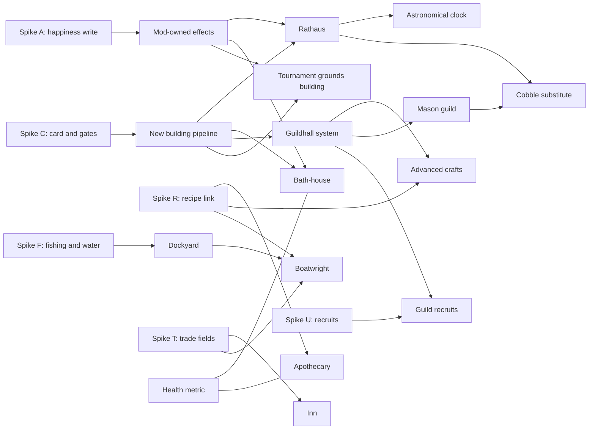

# Recommendation: end-game buildings, guildhalls and Health

Issue: #521. Inputs: `engine-facts.md`, `buildings.md`, `guildhalls.md`, `health-metric.md`. Desk research only; no game run. Nothing here is design: the numbers and the rules stay with the owner.

## Verdict table

| Concept | Verdict | Effort | Key blocker or evidence |
|---|---|---|---|
| Dockyard | Needs a spike (F) | L | Water placement is native or unknown. Row 59 and `BM_SG_FishermansHut` may give fishing without a node. |
| Boatwright | Needs a spike (R, T) | L | Recipe link for a new good. Trade speed is native. Needs the dockyard. |
| Rathaus | Feasible with pak work | M-L | New building pipeline (B). Effects by `changeSilver`, `changeInfluence` (proven). Happiness needs spike A. |
| Astronomical clock | Feasible with pak work | S | After the Rathaus. "Needs Rathaus" rule by card hiding or removal (spike C). |
| Apothecary | Needs a spike (R) | M | Herbs exist. New item row is proven. Recipe link is not. |
| Inn | Needs a spike (T) | M | Merchant visits are native. Tavern clone is easy. |
| Cobblestone roads | Not feasible without native code | n/a | Roads are native; no surface type in data. Substitute: a paved plaza building. |
| Bath-houses | Feasible with pak work | M | B plus a mod-owned happiness effect (spike A). |
| Tournament grounds | Feasible now (menu version) | S (menu), M (building) | Silver, approval or order write and experience write are proven calls. |
| Guildhalls (3 of a type) | Feasible with pak work | M, then S each | B plus a count rule. Refusal needs spike C. |
| Guild income | Feasible now | S | Mod-owned `changeSilver` from production. |
| Advanced crafts | Needs a spike (R) | M | Which items exist; recipe link; `techsRequiredToCraft` gate. |
| Guild recruits | Feasible with pak work (spike U) | M | New unit template row is proven. Recruit call with a new name is not. |
| Health metric | Feasible now | M | Mod-owned metric. Source buildings follow their own verdicts. |

Not one concept needs native code, except real cobblestone roads. No concept is blocked by a proven engine limit. Most of the work is the shared new building pipeline and mod-owned effects.

## Spikes (each is one small OpenSpec change)

| Id | Question | Cost | Unblocks |
|---|---|---|---|
| C | Does a pak-added building id get a build menu card (category, `bVisibleInUi`, `settlementLevel`), and can a run-time write of `bVisibleInUi` show or hide it? Is the `settlementLevel` gate enforced for a new id? Use a clone of an existing row with a vanilla model, so no Meshy work is needed. | S, one game run | Almost everything (B). |
| A | Does a per-tick write of `Region.Approval` hold, and does it change growth, immigration or loyalty? What does the same write of `publicOrder` change natively? | S, 1 to 2 game runs of 10 game days | Rathaus, bath-house, tournament, apothecary, Health penalty. |
| R | Does a new building row with an existing `job` id, plus a new item row with `craftingTool` set, produce the item? Does `techsRequiredToCraft` or `upgradesRequiredToCraft` gate it? | M | Apothecary, boatwright, advanced crafts. |
| F | Can row 59 (Fisherman's Hut) be placed, near water only, and does it make fish with no deposit? Is there a reflected water query? | S to M | Dockyard. |
| T | In `RTSMultiEngineCPP`, `Tradepoint`, `ForeignMarketSupply` and `TradeSettings`: is there a visit interval, a chance or a speed field a mod can write? Can Lua spawn a merchant squad? | S, read only | Inn, boatwright effect. |
| U | Does `addMilitiaSquad(region, FName)` accept a new template row name, and what are the unit roles and gear? | S | Guild recruits. |

Read-only parts (T, parts of F) can run in the bridge on one game. Follow the crash list of `DANGEROUS_ACTIONS.md`: no `GetSquad`, no soft-object rows, no Lua string to an `FName` argument of a component.

## Recommended order

1. **Change `add-health-metric`** (feasible now, no building). Metric, formula, tooltip row, a public order penalty. Uses wells and large churches as sources. Gives the owner something to play while the building spikes run.
2. **Spike C** (card and gates). It decides how the player starts every new building. If no card works, the fallback is a mod menu "Build" button that calls `activateBuildingMode(id)` (proven with a real click).
3. **Spike A** (happiness write). It decides how all "happiness" effects are made.
4. **Change `add-tournament-grounds`** (menu version, then a building after C). Uses A.
5. **Spike R**, then **change `add-guildhalls`** (one guild first, for example blacksmith), then advanced crafts and **spike U** for guild recruits.
6. **Change `add-bath-house`** and **`add-rathaus`** (after C and A). Then the astronomical clock.
7. **Spikes F and T**, then the dockyard, boatwright and inn. These carry the most unknowns and the largest model work.
8. **Cobblestone roads**: ask the owner whether the plaza substitute is acceptable. If not, drop it or file an owner decision for a native layer (`docs/wiki/concepts/native-modding.md`).

## Dependencies

## Questions for the owner

1. Cobblestone roads: is a placeable paved plaza with a mod effect enough? A real new road type needs native code.
2. "Personal wealth" for the tournament: lord treasury (`silver`) or influence?
3. Guild requirement: is "the building is removed with a refund" acceptable if the card cannot be hidden?
4. Dockyard: is a mod-owned trade income acceptable if water trade routes cannot be made?
5. Inn: is a mod-owned "merchant visit" event (silver and goods, a letter) acceptable if the native merchant rate cannot be changed?
6. Numbers (Health decline, source weights, tournament boost and experience): to be set by the owner in `design/mod/`.

## What this assessment did not check

- No game run was made. Every "Unknown" is a spike question above.
- Item ids named in `guildhalls.md` (293, 177, 178) and the id of Herbs were not matched to their text names.
- The table extract in `modtools/work/json/` may be from an older game build than the installed game (the same caution as in the wiki page on unit templates).
